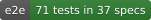
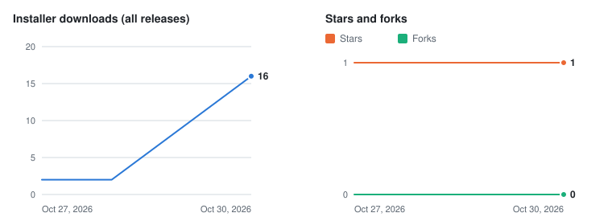

# Action Stations

<p align="center"></p>

**Tabletop exercises written from the plans you already have, on your own computer.**

[](CONTRIBUTING.md#local-ci)
[](CONTRIBUTING.md#tests-in-more-detail)
[](e2e/)
[](CHANGELOG.md)
[](#license)
[](docs/adr/0001-stack.md)
[](#download-and-install)
[](#privacy-and-local-first)
[](#privacy-and-local-first)
[](#project-stats)
[](https://github.com/actionstations-ai/actionstations/stargazers)
[](https://github.com/actionstations-ai/actionstations/forks)

[Download](#download-and-install) · [Quick start](#quick-start) · [Guides](#docs-and-guides) · [Packs](docs/guides/packs.md) · [License](#license) · [Contributing](CONTRIBUTING.md) · [Support](SUPPORT.md) · [Security](SECURITY.md)

Action Stations is a desktop app for macOS, Windows and Linux that writes discussion-based tabletop exercises from your organization's own documents. You import your emergency plans, security programs and procedures; a language model you choose drafts the scenario, the Master Scenario Events List (MSEL), the inject deck with its media, the controller handbook and the player briefing, and every event cites the section of your plans it came from. You read the draft, fix it, run the exercise from the app and export the package. The app started as a set of airport cybersecurity tabletops written by hand for CSAAP, the Cybersecurity for Airports course, and now covers 24 kinds of organization, from transit agencies and water utilities to county 911 centers and school districts.


## Download and install

Download the latest release from the [releases page](https://github.com/actionstations-ai/actionstations/releases) or [actionstations.ai/download](https://actionstations.ai/download/):

- **macOS** (Apple Silicon): the `.dmg`. It is not notarized yet, so macOS blocks the first launch: open System Settings → **Privacy & Security** and click **Open Anyway** (on macOS 14 and earlier, right-click the app and choose **Open**).
- **Windows** (64-bit): the `-setup.exe` installer. It is not code-signed yet, so Windows shows "Windows protected your PC": choose **More info**, then **Run anyway**. PCs with Smart App Control turned on block unsigned apps.
- **Linux** (64-bit): the `.AppImage`. Make it executable (`chmod +x`) before you run it.

The Windows and Linux files each have a `.sha256` checksum beside them. To run the app from source instead, see [Building from source](#building-from-source).

## Quick start

1. Launch the app. The setup wizard opens on the first run. Every step can be skipped and changed later.
2. Choose where models run: **Cloud APIs only**, **Local tools** or **A mix** (see [Models and providers](#models-and-providers)).
3. Pick a text model. The wizard finds LM Studio or Ollama on this computer, or takes an Anthropic API key.
4. Create a project, or open one of the example projects under **Projects → Examples** to see a finished exercise first.
5. Import your plans on **Documents**: PDF, Word, PowerPoint, Excel, Markdown, HTML, plain text, and images with OCR.
6. Check the **Facility facts**, then ask for scenario ideas on **Generate** and generate the one you want.
7. Edit the MSEL and documents, write the injects and render their media, then run the exercise in **Facilitate** or **Export** it.

The [getting started guide](docs/guides/getting-started.md) walks through every step with screenshots, using the sample airport plans in [`reference/ncia/`](reference/ncia/) and LM Studio. With `qwen3-30b-a3b-2507` on that setup, scenario ideas took 13 seconds and a full scenario took 5 minutes 40 seconds.

## What you get

For each scenario, the app writes:

- an overview with objectives, roles and phases, following the HSEEP pattern for a discussion-based exercise;
- a timed MSEL with expected actions and citations into your plans, checked by lint rules for pacing, the mix of injects, roles left without an inject and citations that do not resolve;
- an inject deck: tweets and posts, helpdesk tickets, emails, log files, information boards and HMI screens rendered from HTML templates so their text is exact, photographs and short video from an image or video model, and radio, phone and PA audio from a voice model;
- a controller and evaluator handbook with the rubric, hot wash questions and SimCell scripts;
- a player briefing packet with blank ICS 201 and ICS 203 forms.

Everything is editable in the app. **Facilitate** runs the exercise: an exercise clock with time jumps, the MSEL timeline with due injects, a presentation window for a second display, and notes for the hot wash. **Export** writes PDFs (MSEL, master inject deck, controller handbook, player briefing, a combined exercise plan), Word copies of the handbook and briefing, the media files, the scenario as JSON and Markdown, and a distribution ZIP that keeps controller material apart from what players see.

The Projects screen shows a tip of the day from a list shipped with the app, each linking to the guide section that explains it; **Next tip**, **Hide** and **Turn off tips** are on the card, and **Settings → General** turns tips back on.

Nine example projects ship with the app, each built from a simulated organization's plans: North Coast International Airport (the eight original CSAAP scenarios), a city water department, a drone operator, a chemical plant, a county health department, a county 911 center, a county board of elections, a school district and a gas utility.

The model writes a first draft. A person who knows the organization still has to read it, correct it and decide what reaches the room.

## Models and providers

Action Stations does not include a language model. You connect the ones you want under **Providers**, and each task (ideation, drafting, critique, embeddings, image, video, audio) can go to a different one. A project can override the routing for itself.

| Provider     | What it does                      | Where it runs                                                                            |
| ------------ | --------------------------------- | ---------------------------------------------------------------------------------------- |
| LM Studio    | Text (OpenAI-compatible)          | Your computer, `http://localhost:1234/v1`                                                |
| Ollama       | Text and embeddings               | Your computer, `http://localhost:11434`                                                  |
| Anthropic    | Text, with Claude models          | Anthropic's API. Prompts and excerpts from your documents leave your computer.           |
| ComfyUI      | Images and video                  | Your computer, `http://127.0.0.1:8188`, with the default workflows in `comfy/workflows/` |
| Local TTS    | Speech (mlx-audio, Apple Silicon) | Your computer, `http://127.0.0.1:8765`                                                   |
| System voice | Speech                            | Your computer: macOS `say`, Windows SAPI, or `espeak-ng` on Linux. No setup.             |

**Detect local services** on the Providers page finds LM Studio, Ollama, ComfyUI and the system voice on this computer and adds them in one click.

Setting up local tools is optional. The wizard step **Where models run**, also under **Settings → Local tools**, offers three choices:

- **Cloud APIs only**: nothing is detected, downloaded or installed. You add an API key.
- **Local tools**: LM Studio, Ollama, ComfyUI and local voice are each shown as detected, installed but not running (with **Start**), or not installed. **Download and install** fetches the vendor's own installer only when you click it, and checks the publisher's signature (macOS, Windows) or Ollama's published sha256 (Linux, installed in your home folder without sudo) before anything runs. Recommended models for this computer's memory are separate, optional downloads.
- **A mix** of both.

Without any provider the app still imports and searches documents, using a built-in keyword embedder that works offline. The [provider guides](docs/guides/providers/README.md) have setup steps, measured timings, costs for the Anthropic models and troubleshooting.

## Packs

A pack (`.aspack` file) adds inject templates, prompts, domain profiles, ComfyUI workflows, reference documents or example projects without a new app release. The app's own content ships the same way: **Action Stations Core** and one pack per domain appear under **Included with the app** on the **Packs** screen, where you can turn off a domain you never exercise.

You can install a pack from a file, a URL or a catalog. No catalog is set up by default, and nothing is fetched until you add one and refresh it. Every pack shows a review before it installs: its licenses, any custom ComfyUI nodes it needs, and the archive's sha256. Packs are checked by SHA-256, not signed. A project keeps its own copy of the pack items it uses, so it still opens after the pack is updated or removed. **Export as pack…** builds a pack from your own templates, prompts, workflows and a project. See the [Packs guide](docs/guides/packs.md).

## Privacy and local-first

- There is no account, no sign-in and no telemetry. The app makes network calls only to the providers and pack catalogs you add, to download sites when you click a download or install button (local tools, recommended models, the local embedding model), and to GitHub's releases API if you turn on the update check (off by default; it sends the app's name and version, never anything about you or your projects, and never downloads an update).
- With local models (LM Studio, Ollama, ComfyUI and a local or system voice) it works without an internet connection. A cloud provider such as Anthropic receives your prompts and the document excerpts used to ground them.
- A project is a folder of JSON, Markdown and media files (`<name>.asproj`) on your disk, by default in `~/Documents/Action Stations`. You can copy it, back it up or put it in version control.
- API keys are encrypted with your operating system's keychain (Electron `safeStorage`) and stored as ciphertext in `secrets.json` in the settings folder. They never go into project files, `settings.json` or logs. If the operating system cannot encrypt them (for example Linux without a keyring), the app refuses to store keys.
- Settings live in `~/Library/Application Support/Action Stations` (macOS), `%APPDATA%\Action Stations` (Windows) or `~/.config/Action Stations` (Linux).

The app was called Tabletop Generator before version 0.2.0. The first launch after updating moves the old settings and projects folders to the new names, and projects named `<name>.ttxproj` keep opening as they are.

## Docs and guides

| Guide                                                               | What it covers                                                                                                                                                                                                                                                                                                   |
| ------------------------------------------------------------------- | ---------------------------------------------------------------------------------------------------------------------------------------------------------------------------------------------------------------------------------------------------------------------------------------------------------------- |
| [Getting started](docs/guides/getting-started.md)                   | Install, create a project, import and search documents, connect a model, generate, edit, facilitate and export a scenario.                                                                                                                                                                                       |
| [Provider setup](docs/guides/providers/README.md)                   | Routing, embeddings, local tools setup, and step-by-step setup for [LM Studio](docs/guides/providers/lm-studio.md), [Ollama](docs/guides/providers/ollama.md), [Anthropic](docs/guides/providers/anthropic.md), [ComfyUI](docs/guides/providers/comfyui.md) and [local TTS](docs/guides/providers/local-tts.md). |
| [How a good tabletop exercise is built](docs/guides/methodology.md) | The exercise design the app follows.                                                                                                                                                                                                                                                                             |
| [Prompts](docs/guides/prompts.md)                                   | How prompts are layered, what each stage can use, and how to change them safely.                                                                                                                                                                                                                                 |
| [Template authoring](docs/guides/templates.md)                      | Writing inject templates and golden images, and adding a new inject type.                                                                                                                                                                                                                                        |
| [Packs](docs/guides/packs.md)                                       | Installing packs, reading the review, and exporting and sharing your own.                                                                                                                                                                                                                                        |

The [CHANGELOG](CHANGELOG.md) lists what changed in each version. Design documents, the architecture and the decision records are listed in [CONTRIBUTING.md](CONTRIBUTING.md#design-documents).

## Building from source

### Prerequisites

- macOS, Windows or Linux.
- [Git LFS](https://git-lfs.com) (`brew install git-lfs`, or your package manager), then `git lfs install` once, before cloning: images, documents, fonts and media are stored with it.
- Node.js 22.12 or later and pnpm 10 (`corepack enable && corepack prepare pnpm@10 --activate`).
- Native build tools, in case a native module (`better-sqlite3`) has no prebuilt binary for your platform:
  - macOS: Xcode Command Line Tools (`xcode-select --install`)
  - Windows: Visual Studio Build Tools with the "Desktop development with C++" workload
  - Linux: `build-essential` and `python3`

### Build and run

```bash
git clone https://github.com/actionstations-ai/actionstations.git
cd actionstations
pnpm install      # installs dependencies and rebuilds native modules for Electron
pnpm dev          # runs the app with hot reload
pnpm test         # unit tests
pnpm build        # installers for this operating system in release/<version>/
```

`pnpm build:app && pnpm start` runs the production build without packaging it.

### Pointing the app at LM Studio and ComfyUI

- **LM Studio:** start the server (Developer tab, or `lms server start`) and load a model with at least 32K context, for example `lms load qwen/qwen3-30b-a3b-2507 --context-length 32768 -y`. In the app, open **Providers**, click **Detect local services** and **Add** LM Studio, then route **Ideation**, **Drafting** and **Critique** to it. See the [LM Studio guide](docs/guides/providers/lm-studio.md).
- **ComfyUI:** start ComfyUI on `http://127.0.0.1:8188` (ComfyUI Desktop on port 8000 is also found) with the SDXL and LTX-Video models, then **Detect local services** and route **Image** and **Video** to it. The app reports any custom nodes a workflow needs that ComfyUI is missing. See the [ComfyUI guide](docs/guides/providers/comfyui.md).

## Contributing

Bug reports, feature requests and pull requests are welcome. [CONTRIBUTING.md](CONTRIBUTING.md) has the project rules, the workflow, the local CI and the test commands. Questions and bugs go through [SUPPORT.md](SUPPORT.md). Report a vulnerability privately by email, never in a public issue: see [SECURITY.md](SECURITY.md). Everyone taking part follows the [Code of Conduct](CODE_OF_CONDUCT.md) (Contributor Covenant 2.1).

## License

Source-available under the [PolyForm Internal Use License 1.0.0](LICENSE.md): any organization may use and change Action Stations for free for its own internal operations, including running exercises for its own people. Schools, colleges and universities, their faculty, staff and students, may also use it for teaching, coursework, research and student exercises under the [Additional Permission for Education](LICENSE-EDUCATION.md). Selling or redistributing it, hosting it for others, and consulting, training or facilitation for other organizations need a commercial license; see [COMMERCIAL.md](COMMERCIAL.md). Contributions are accepted under the [CLA](CLA.md). Third-party dependencies keep their own licenses, and packs carry the license their author chose.

## Project stats

Installer downloads across all releases, with stars and forks. GitHub keeps only a running total per release file, so `pnpm stats` (also run by each release) records a dated snapshot in [docs/stats/history.json](docs/stats/history.json) and redraws this chart.

<picture>
  <source media="(prefers-color-scheme: dark)" srcset="docs/stats/downloads-dark.svg">
  
</picture>

Stars over time, from [star-history.com](https://star-history.com/#actionstations-ai/actionstations&Date):

<a href="https://star-history.com/#actionstations-ai/actionstations&Date">
  <picture>
    <source media="(prefers-color-scheme: dark)" srcset="https://api.star-history.com/svg?repos=actionstations-ai/actionstations&type=Date&theme=dark">
    
  </picture>
</a>
