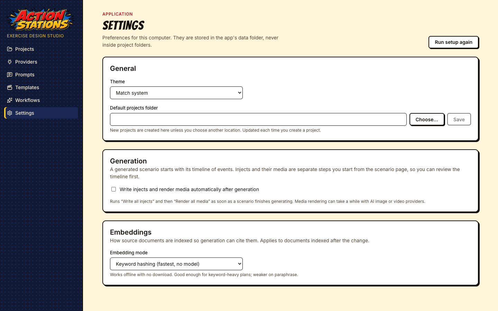
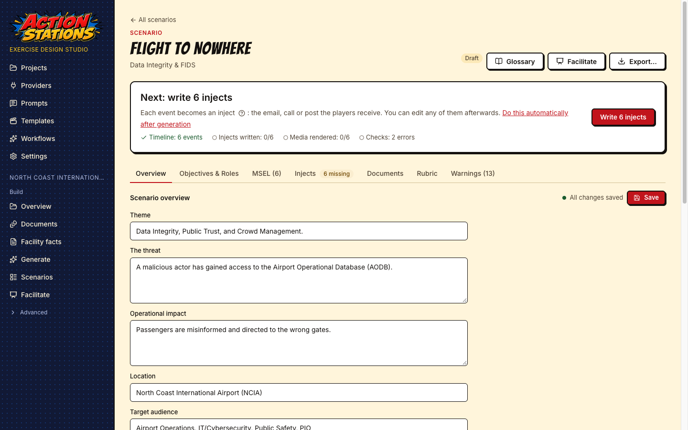
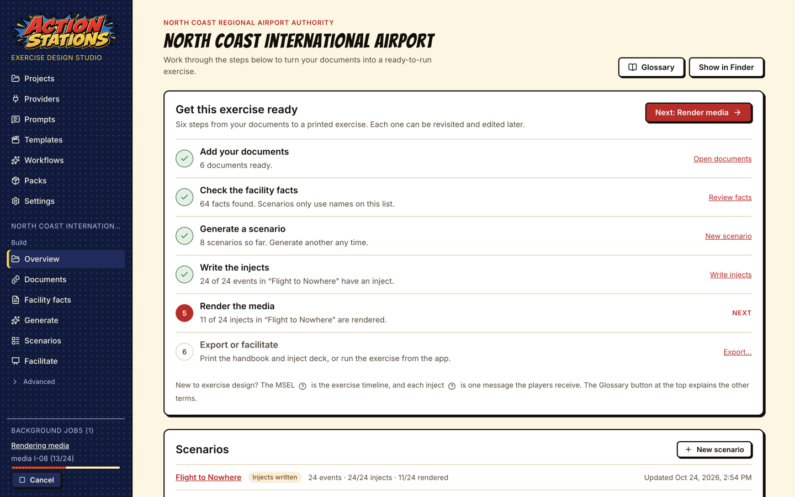

# Getting started

This walk-through takes you from a fresh install to a generated exercise: create a project, import an organization's plans, search them, connect a local model, ask for scenario ideas, generate a full scenario (overview, roles, phases, MSEL, controller handbook, rubric, player briefing and hot wash), write the inject deck with its media, edit everything, export the exercise package, and run it in facilitator mode.

It uses the fictional North Coast International Airport (NCIA) plans that ship in [`reference/ncia/`](../../reference/ncia/), and LM Studio with `qwen3-30b-a3b-2507`. The timings come from that setup in the built app: ideas took 13 seconds, and the scenario took 5 minutes 40 seconds (39 MSEL rows, every stage `ok`). The screenshots are taken from the built app by `e2e/guide-screenshots.spec.ts` (`pnpm build:app && GUIDE_SHOTS=1 pnpm exec playwright test e2e/guide-screenshots.spec.ts`), offline with the built-in mock provider, so the stages show `mock-large` instead of a real model; the MSEL, inject, facilitator and export screens show **Flight to Nowhere** from the bundled airport example (see [Example projects](#example-projects)).

Background reading: [How a good tabletop exercise is built](methodology.md).

## 1. Install and launch

Download the installer for your system from the [latest release](https://github.com/actionstations-ai/actionstations/releases/latest) (see [Updates](#updates) for checking the download and the warnings unsigned installers get), or run the app from source as below.

Prerequisites: [Git LFS](https://git-lfs.com) (run `git lfs install` once before cloning), Node.js 22.12 or later, pnpm 10 (`corepack enable && corepack prepare pnpm@10 --activate`), and on macOS the Xcode Command Line Tools (`xcode-select --install`) in case a native module has to be compiled. See the [README](../../README.md#prerequisites) for Windows and Linux.

```bash
git clone https://github.com/actionstations-ai/actionstations.git
cd actionstations
pnpm install
pnpm dev
```

`pnpm install` also rebuilds the native modules (SQLite and its vector extension) for Electron. `pnpm dev` opens the app with hot reload; `pnpm build:app && pnpm start` runs the production build instead.

On first launch the **setup wizard** opens. It has six steps, each of which can be skipped and changed later:

1. **Welcome**: what the app makes and what stays on your computer.
2. **Where models run**: **Cloud APIs only** (add an API key on the next step; nothing is installed), **Local tools**, or **A mix**. For local tools it lists LM Studio, Ollama, ComfyUI and local voice, each as **Detected** (running), **Installed, not running** (with **Start**) or **Not installed** (with **Download and install**, **Open the download page** or **Skip**), with its size and license, followed by recommended models for this computer's memory, each its own optional download. Installs fetch only the vendor's official installer, on your click, and check the publisher signature before anything runs (on Linux, Ollama installs into your home folder without sudo after checking its published sha256) (see [Local tools setup](providers/README.md#local-tools-setup)). The same choice is in **Settings → Local tools**.
3. **Text model**: detects LM Studio and Ollama on this computer, lets you pick a model (embedding models are never offered as the writing model; the largest chat model is the default unless one is already loaded) and add the provider with one click, or add an Anthropic API key. It routes ideation, drafting and critique to your choice.
4. **Media**: checks ComfyUI and its default workflows for images and video, and adds a local voice server (mlx-audio) for speech; it routes the image, video and audio tasks. The operating system's own voice is added later from **Providers** (step 5 below).
5. **Search quality**: keep the built-in keyword hashing, or download the local embedding model (133 MB, once) for better search.
6. **First project**: create a project.


**Skip setup** goes straight to the Projects screen. You can run the wizard again from **Settings → Run setup again**. The rest of this guide shows the same steps on the regular screens, which is also where you change them later.



The Projects screen shows a **Tip** card: one short tip about a feature, with a link to the guide section that explains it (opened in your browser). **Next tip** shows another, **Hide** removes the card until the next launch, and **Turn off tips** removes it for good. Each launch starts with the tip after the last one shown. Tips ship with the app, so showing them sends nothing over the network. Turn them back on with **Settings → General → Show a tip on the Projects screen**.

**Settings** also holds the default projects folder, the theme, the tip of the day, the embedding mode and **Generation → Write injects and render media automatically after generation** (see step 8).

### Updates

The app can tell you when a newer release is out. The check is off until you turn it on: the setup wizard's last step has an unticked box **Check for new versions of Action Stations when the app starts**, and if you skipped the wizard, the Projects screen asks once (**Turn on** or **No thanks**; unanswered, it asks on three launches and then counts as no). Change it any time in **Settings → Updates**.

With the check on, the app sends one request to `api.github.com` at most once a day, 10 seconds after it starts. The request names the app and its version (`User-Agent: ActionStations/0.6.0`) and nothing else: no account, no cookies, nothing about you or your projects. GitHub sees your IP address. **Settings → Updates → Check now** checks at once, whatever the setting, and shows the installed version, the time of the last check and its result. Failures (offline, timed out, GitHub's limit of 60 checks an hour from one network) are shown only there.

When a newer release exists, the Projects screen shows **Action Stations X.Y.Z is available**, with **Release notes**, **Download page** and **Not now** (which hides that version; a later one shows again). The release notes name the installer for your computer and its `.sha256` file. The app never downloads or installs anything: **Download page** opens the release on GitHub in your browser. To install:

1. Download the installer and its `.sha256` file from the release page.
2. Check the download: `shasum -a 256 <file>` (macOS, Linux) or `Get-FileHash <file> -Algorithm SHA256` (Windows PowerShell) must print the hash in the `.sha256` file.
3. The installers are not code-signed yet, so your operating system warns. macOS: on macOS 15 and later open System Settings → **Privacy & Security** and click **Open Anyway** (on macOS 14 and earlier, right-click the app and choose **Open**). Windows: "Windows protected your PC" → **More info** → **Run anyway**. Linux: `chmod +x` the AppImage and run it.

If you installed 0.5.0 on Windows, uninstall it before installing a later version: the app id changed in 0.5.1, so Windows would otherwise keep two copies. Your settings and projects stay. The banner and the release notes say so when it applies.

### Updating from Tabletop Generator

The app was called Tabletop Generator before version 0.2.0. The first launch after updating moves its settings folder (`~/Library/Application Support/Tabletop Generator` on macOS, `%APPDATA%\Tabletop Generator` on Windows, `~/.config/Tabletop Generator` on Linux) to `Action Stations` in the same place, and moves `Documents/Tabletop Generator` to `Documents/Action Stations`; recent projects follow. If a folder cannot be moved, it is copied and the old one is kept; if the copy fails too, the app keeps using the old folder. Saved API keys normally carry over. A key that cannot be unlocked under the new name is kept aside, encrypted, and **Providers** shows a notice and a **Key needs re-entry** badge on that provider: open it with **Edit** and paste the key again.

The sidebar has two parts: application screens (Projects, Providers, Prompts, Templates, Workflows, Settings) and, once a project is open, that project's screens. These are grouped into **Build** (Overview, Documents, Facility facts, Generate, Scenarios, Facilitate) and a collapsible **Advanced** group (Search index, Prompt overrides, Provider routing). Advanced starts closed, remembers whether you opened it, and stays open while you are on one of its pages.

## 2. Create a project

A project is a folder on disk that holds one organization's documents and every exercise built from them. You can copy it, back it up or put it under version control.

Click **New project** and fill in:

- **Project name**: also used for the folder name (`<name>.asproj`). Projects made before the app was renamed are named `<name>.ttxproj`; they open, list and duplicate the same way. On macOS, double-clicking a project folder in Finder opens it in the app.
- **Organization**: the name as it should appear in briefings and injects.
- **Domain**: the kind of organization (a domain profile, ADR-0014): Airport, Transit (bus / rail), Dam / water authority, Water utility, Energy utility, Healthcare, Campus, Stadium / venue, Port / maritime, Municipal government, Industrial / manufacturing, Unmanned systems operator, K-12 school district, Commercial facilities (retail, lodging, casino), Food and agriculture, Telecommunications carrier / ISP, Data center / IT service provider, Community bank / credit union or Generic organization. Type in the search box (`bus`, `dam`, `hospital`, `drone`, `school`, `bank`) to narrow the list, then click a profile or move with the arrow keys. The profile sets the vocabulary, the facility-fact categories, typical roles and outside parties, and the threat families the generator offers. Projects created before profiles existed keep their stored value; the picker says which profile it resolves to (for example _Saved as “hospital”, which uses the Healthcare profile_).
- **Location**: the parent folder (**Choose…** opens a folder picker). Set a default under **Settings → Default projects folder**.


**Create project** opens the project's **Overview**. At the top, **Get this exercise ready** lists the six steps (add documents, check the facility facts, generate a scenario, write the injects, render the media, export or facilitate) with what is done so far; the **Next** button opens the first step still to do. Below it are the project's scenarios with their status, and a collapsed **Project settings** section (it remembers whether you left it open). The **Glossary** button explains terms such as MSEL, inject, STARTEX / ENDEX, SimCell and hot wash; a **?** next to a term explains just that one.

Open **Project settings** to edit the project. The same domain picker is under **Organization**; below it, **Customize vocabulary** edits this project's player roles, outside parties, IT systems and OT / control systems as chip lists (type and press Enter to add, **×** to remove). A list you change replaces the profile's list for this project only; **Reset to … defaults** removes your changes. Fill in **Brand and locale** (city, region, primary colour, and an optional **Logo**: **Choose logo…** copies a PNG, JPEG or WebP of up to 2 MB into the project's `brand/` folder at once; memos, press releases, SITREPs, letters from your own organization and the exercise plan cover then show it) and **Aliases** (for example `orgShort` → `NCIA`, `localTv` → `Channel 5`): inject templates read these instead of hard-coding names. **Default roles** pre-fills the player roles of new scenarios. Click **Save settings**.


### Example projects

**Projects → Examples** lists ready-made projects built from fictional organizations' documents, each with its domain, a summary and its scenarios (with their threat families). **Open a copy** asks where to put the copy (default: the default projects folder from Settings, else a folder in your Documents folder), copies the example into a new folder (never over an existing one: a second copy gets `-2`), and opens it. The example as shipped is never changed. A project opened from an example shows the example's notice at the top of every project screen. The search index is not shipped; it is rebuilt from the documents when the copy opens, as it is for any project folder opened without `index.sqlite` (a duplicate, or a folder from version control). The setup wizard's **First project** step offers the same examples under **Or explore an example**. Examples from enabled packs are listed too, with a line naming the pack, its version and its license (for example _From the Freight Rail Operations pack (1.0.0) · License CC-BY-4.0_); a copy of one names the pack in its notice, and keeps working after the pack is disabled or uninstalled, including its domain profile.

The project folder contains `project.json`, `documents/`, `scenarios/`, `prompts/` (project prompt overrides), `index.sqlite` (the search index), `ideas.json` and `facility-facts.md` (see [Facility facts](#facility-facts)). Its `.gitignore` excludes the search index and caches, which can be rebuilt.

## 3. Import documents

Open **Documents** and click **Import documents…**, or drop files anywhere on the window. PDF, Word, PowerPoint, Excel, Markdown, HTML, plain text and images (with OCR) are supported. Each file is copied into the project's `documents/` folder, parsed into heading-aware sections and indexed. For this walk-through, import the six Markdown files in `reference/ncia/` and `reference/ics-forms/`.


Measured: the six NCIA documents imported and indexed in 0.4 seconds (142 sections).

For each document, check:

- **Title** and **Short name**: citations read as `<short name> › <section>`, for example `TIRP › Section 13 › 13.6`. Click a title or short name to edit it.
- **Kind**: plan, policy, map, form, course, prior exercise or other.
- **Status**: **Indexed** when the document is searchable.

The **Embeddings** line shows the index's embedding mode (with this project's Embeddings routing when it overrides the global one). The default, **Keyword hashing**, works offline with no download; see [Embeddings](providers/README.md#embeddings) for the other modes and their current limits. After changing the mode, click **Rebuild index**.

### Facility facts

After every import or **Rebuild index** the app writes `facility-facts.md` in the project folder: the runways, taxiways, gates, concourses, rooms and areas, equipment, hostnames, IP ranges, phone numbers and agencies your documents state, one `## Section` per category and one `- ` bullet per identifier. Generation hands this list to the model as the only real identifiers, and the MSEL check flags rows that name a runway, taxiway, gate or concourse that is not in it (unless the row frames it as the attacker's fake data).

Some nouns name different things in different rows. A dam's "Unit 4" is a generating unit in a powerhouse row and a sheriff's patrol car in a security row, so the profile checks the broad noun (Unit, Gate, Zone, Station, Section, Route) only when the row is about that kind of thing (for a dam unit: generation, turbines, the powerhouse, MW) and never after a responder or access word ("Patrol Unit 4", "Access Gate 2", "State Route 9"). The specific nouns ("Generating Unit 3", "Spillway Gate 6", "Inundation Zone D") are always checked. A name that is close to a documented one is reported as a suggestion: "Confluence Park Station (did you mean Confluence Station?)".

Open **Facility facts** in the project sidebar to correct the list. Each category is a section; every entry shows whether it came **From documents** (with where it was found, for example _Airport Emergency Plan › 2.2 Scope_) or was **Added by you**.


- **Add** what the extraction missed, for example a runway that only appears on an image-only map: type `9/27` in **Add to Runways** and press Enter. Paste a list to add one entry per line. Rows naming Runway 9 or 27 are then accepted.
- **Edit or remove** what is wrong, for example a gate range that belongs to the perimeter fence rather than the terminal: change the entry, or press **×** (or Backspace in an empty entry). Extracted entries you removed are listed under the section with **Restore**. Rows naming a removed gate are then flagged.
- **Add a category** under **Add a category** (for example _Pump stations_); its entries are shown to the model but not linted until you give it a lint definition (see [What lint looks for](#what-lint-looks-for)). Only categories marked **Checked by lint** produce warnings.

**Save** (or Ctrl+S / Cmd+S) writes `facility-facts.md`; **Discard changes** goes back to the saved file. After every save the **Scenario check** re-lints the project's scenarios and says how many unknown-identifier warnings (FACILITY_UNKNOWN_ID) there are now compared with when you opened the screen; **Check scenarios** runs it again, and each scenario's **Warnings** tab shows the rows.

To catch impossible quantities, add a section named **Limits** with one bound per entry, written `<what>: <number> <unit>`, for example `Chlorine, largest container: 1 ton` or `Pressure District 7 MAOP: 2 psig`. A row that names every key word of an entry and, in the same sentence, a larger amount of the same kind (mass in lb, tons, tonnes or kg; volume in gallons, liters, barrels or m³; pressure in psi, psig, bar, kPa or in. w.c.) gets a `QUANTITY_OVER_LIMIT` warning. Rates such as "40 lb a minute" are not checked.

You can also edit `facility-facts.md` in any text editor: one `## Section` per category and one `- ` bullet per entry. If the file changes on disk while the screen has unsaved edits, Save is refused and the screen offers to reload the file.

Your edits win. Once you have changed the file, importing more documents no longer overwrites it; the fresh extraction is written to `facility-facts.generated.md` next to it, and the screen lists what it found that your list lacks. To start over from the documents, click **Reset to extracted facts** and confirm. Every save and reset first keeps the previous file in `.cache/facility-facts-history/` (the last 20 versions; the project's `.gitignore` excludes `.cache/`).

#### What lint looks for

Each category the domain profile defines has **Edit lint definition** under its heading: what the extraction and the Scenario check look for in a text. The fields are:

- **Noun**: the word before an identifier, as a case-insensitive regular expression: `|` between alternatives, `?` for an optional letter, `(?:…)` for a group. Airports use `Gates?`; tightening it to `Jet Gates?` stops a row about "Gate 99" at the perimeter fence from being flagged.
- **Generic noun** and **Context**: a broader noun (`Units?`) that counts only where the context matches (`turbine|powerhouse|\bMW\b`) and never after a qualifier such as _Patrol_ or _Access_. A generic noun needs a context.
- **Identifier shape**: letters and numbers (`A1`, `B12`, ranges `A1–A8`), numbers only, runway pairs (`5/23`), or a noun glued to a number (`RTU-07`).
- **Checked by lint** and **Complete list** (the model sees every identifier instead of the first 20).

Enter in any field saves, Escape closes the form. Patterns that are not valid, use capturing groups `(…)`, look-arounds or back-references, repeat a group that itself repeats (`(?:a+)+`), match empty text or run longer than 200 characters (400 for a context) are refused with the reason. Saving writes the project's whole category list to `domainProfileOverrides.factCategories` in `project.json`, extracts the facts again and re-runs the Scenario check. If you have edited `facility-facts.md`, it is kept and the new extraction goes to `facility-facts.generated.md` (shown under "From the documents, not in your list"); lint uses the new definition right away. **Use the domain's definition** undoes the change for one category. Save or discard unsaved entry edits first.

A category you added yourself (for example _Pump stations_) has **Define for lint** once the file is saved. It opens the same form with an empty noun: give one (`Pump Stations?`), choose the identifier shape (numbers only for `Pump Station 7`) and save. The definition is added after the domain's categories in `domainProfileOverrides.factCategories` under the category's id from `facility-facts.md` (`pump-stations`, as written in the `<!-- category: pump-stations -->` line), so nothing in the file is renamed; from then on a row naming Pump Station 7 when the list has 1 and 2 gets a FACILITY_UNKNOWN_ID warning. **Remove the lint definition** takes it out again and the category goes back to being shown to the model only. The built-in categories without a noun (hosts, phone numbers, networks and the like) are not offered a definition.

## 4. Search the plans

Open **Search index** and try the systems your exercise should test, for example `FIDS failure manual announcements`. This is the same hybrid search (keyword plus vector, fused by rank) that every generation stage uses to retrieve and cite sections, so it shows what the generator will find.


Here the top hit is `TIRP › Section 13 › 13.6 Scenario C: FIDS / BHS System Failure`, followed by AEP Appendix 6. If a section you care about does not come up, retitle the document, check that it was parsed with its headings, or add the plan's own wording to your brief.

## 5. Connect a model

Generation needs a text model. If you set one up in the wizard, skip to step 6. This walk-through uses LM Studio; see the [provider guides](providers/README.md) for [LM Studio](providers/lm-studio.md), [Ollama](providers/ollama.md), [Anthropic](providers/anthropic.md), [ComfyUI](providers/comfyui.md) and [local TTS](providers/local-tts.md).

1. Start LM Studio's server and load a model with at least 32K context:

   ```bash
   lms server start
   lms load qwen/qwen3-30b-a3b-2507 --identifier qwen3-30b-a3b-2507 --context-length 32768 -y
   ```

2. In the app, open **Providers** and click **Detect local services**. It looks for LM Studio, Ollama, ComfyUI and a system voice (macOS `say`, Windows SAPI, `espeak-ng` on Linux) on this computer only; a row appears only for what it finds. Click **Add** next to LM Studio.

   

3. On the LM Studio card, click **Edit** and set **Default model** to `qwen3-30b-a3b-2507` (detection picks the first model alphabetically). Click **Test**: it should answer "OK" in well under a second.
4. In **Routing**, set **Ideation**, **Drafting** and **Critique** to LM Studio. To have voice lines without a TTS server, **Add** the **System voice** row as well and set **Audio** to it (see [System voice](providers/local-tts.md#system-voice-any-platform)).

   

A project can override any routing row on its own **Provider routing** page.

## 6. Ask for ideas

Open **Generate** and choose **Give me ideas**. Optionally type a focus ("insider threat", "baggage systems, severe weather plus a cyber twist"), choose how many ideas (1 to 12), and click **Give me ideas**.

The model reads the sections retrieved from your plans and proposes distinct concepts, each with a hook, the threat, the systems affected, why it teaches, suggested roles, a difficulty, and the plan sections it exercises (as citation chips).


Measured: 4 ideas in 13 seconds.

## 7. Generate the scenario

Click **Develop this** on an idea. The **From a prompt** tab opens with the brief filled in from the idea: threat or theme, audience roles, duration, number of phases, start time, learning objectives, and constraints (the plan sections it must test). Edit anything, then click **Generate scenario**.


You can also start from **From a prompt** without an idea: describe the threat, list the roles and constraints, and generate.

**Threat family** sets the phase arc, the decision points and the lint checks of the scenario (cyber, cyber-physical, physical security, UAS / drone, insider, natural hazard, infrastructure failure, mass gathering; only the families the project's domain supports are listed). It starts on **Use the suggestion**, which shows the family the generator would pick and why: the idea you are developing, words in the brief (_the brief mentions “drone”_), or the domain's default. The suggestion updates as you edit the brief. Choose a family to override it; your choice is what the scenario gets. Idea cards show each idea's threat family too.

The scenario page opens and follows the run: the bar above the tabs reads **Generating the scenario…** with a progress bar, and the collapsed **Advanced information** section at the bottom of the page opens on its own while the job runs. In it, **Stages** lists each completed stage with its model, tokens and duration, and the **Generation log** streams progress and each stage's raw output. Click **Advanced information** to close or reopen it at any time.


The stages run in this order: scenario overview, objectives & roles, phase plan, one MSEL phase per exercise phase, controller handbook, rubric, evaluation guides, player briefing, hot wash, critique, and a revision pass over the MSEL phases using the critique. You can leave the page; the job keeps running, the sidebar's **Background jobs** list shows it (see [Background jobs and restarts](#background-jobs-and-restarts)), and the page picks it up again when you return.

Measured with `qwen3-30b-a3b-2507` on Apple Silicon: 340 seconds end to end, MSEL phases of 21,000 to 29,500 input tokens each.

## 8. Read and edit the result

When the run finishes, the bar above the tabs says what to do next, with one button for it and a progress line (**Timeline: N events**, **Injects written: n/N**, **Media rendered: n/N**, **Checks: no errors** or the error count):

1. **Next: write N injects** with **Write N injects** (the same job as **Write all injects** on the Injects tab).
2. **Next: render media (n/N)** with **Render media**.
3. **Next: fix N errors found by the checks** with **Show the errors** (opens the Warnings tab), only while lint reports errors; you can still export.
4. **Ready. Next: generate the evaluation guides** with **Generate evaluation guides**, when a ready scenario has none yet (one written before 0.6.0, or a hand-authored one). One model call runs the `eeg` stage alone; nothing else in the scenario changes, and **Facilitate** and **Export…** are already available.
5. **Ready: export or facilitate** with **Facilitate** and **Export…**.

While one of these jobs runs, the bar shows it (**Writing injects…**, **Rendering media…**) with its progress. The status badge in the header follows the same steps: **Draft** (injects missing), **Injects written**, **Media rendered**, and **Ready** once every inject is rendered and lint reports no errors. Next to it are **Glossary** and, until the scenario is ready, **Facilitate** and **Export…**. To have the injects written and the media rendered as soon as generation finishes, turn on **Settings → Generation → Write injects and render media automatically after generation** (off by default; the bar links to it).



The tabs below the bar hold the scenario, and every tab is editable:

- **Overview**: location, audience, theme, threat, operational impact and the core plan sections tested.
- **Objectives & Roles**: exercise objectives, player roles with their standing orders, critical resources, and the SimCell scripts.
- **MSEL**: the grid editor (below).
- **Injects**: the inject deck, one card per MSEL row (below).
- **Documents**: the **Controller handbook**, **Player briefing**, **Hot wash guide** (with its structured questions), the **MSEL document**, and two optional hand-written documents: **Player handouts** (reference cards, evidence packets, clue cards the players get) and **Controller materials** (facilitator-only material such as a clue-card deck with controller notes), each in a document editor (below). No generation stage writes the handouts; write or paste them yourself.
- **Rubric**: grading metrics with points and Fail / Pass / Excellence behaviours, linked to injects.
- **Evaluation**: each objective's FEMA Core Capabilities (pick from the 32, grouped by mission area) and one **Exercise Evaluation Guide** (EEG) per capability: a capability target in your organization's words and three to eight critical tasks, each quoting the plan section it comes from ("per TIRP 13.7, notify the FBI Cyber Task Force and CISA"), the role expected to perform it, its timing when the plan states one, and the MSEL rows where an evaluator would see it. Edit any of it; a task you write by hand picks its source from the plan sections the scenario already cites and is kept when you regenerate. **Criteria by MSEL row** shows what evaluators rate on each inject: its linked tasks, or its expected action when no task names it. Ratings are about procedures, not people.
- **Warnings**: deterministic lint findings (for example a role with no inject in a phase) and the critique's findings. Each one leads with a plain-language sentence, then the checker's detail and its code (for example `ROLE_NO_INJECT`). **Must fix** items come first; **Go to row** opens the MSEL tab on that row, **Open inject** opens the inject. The tab's count is the same live check as the list. Below the checks, **Review notes** lists what the critique flagged when it read the scenario. Once you edit a note's row, or the inject written from it, the note may quote text that is gone: it moves under **N older notes on rows changed since the review**, folded away. Saving an inject whose fields now match its template also clears its field warnings (including "fields repaired to fit the template").

  

Everything is stored in `<project>/scenarios/<id>/`: `scenario.json`, the idea it was developed from (`idea.json`), and the handbook, briefing and hot wash as Markdown under `documents/`. The **Scenarios** page lists every scenario in the project.

### The MSEL editor


- Click a cell, or move with the arrow keys, Home/End and Page Up/Down; **Enter** edits and saves the cell, **Tab** moves on, **Esc** cancels.
- **Add row** and **Insert control card** (a time jump) add rows; drag a row by its handle to retime it (**Drag snaps to** sets the step).
- Select rows with their checkboxes to **Shift times by** a number of minutes or **Move to** another phase.
- **Renumber IDs…** previews and applies `I-01`, `I-02`, … in time order; rubric links and the injects attached to each row follow the new IDs.
- Lock a row (padlock) to keep it when the MSEL stage is re-run.
- Rows that the evaluation guides link to show "Criteria: T-01, T-04" under the expected action. **Criteria column** in the toolbar adds a read-only column with the same task ids (hover for the task text); the arrow keys skip it.
- The lint bar shows the current warnings; warnings never block saving.
- Edits save automatically, also when you switch tab or page right after an edit. A save only replaces the phases and MSEL rows: if the scenario changed meanwhile (a job or another editor wrote it), your edit is applied onto the newer copy. **Undo**/**Redo** and **History** (saved snapshots you can restore) are in the toolbar.

### The document editors


Each document has a formatting toolbar, a **Markdown source** toggle, autosave plus **Save**, and **History** with a diff against the current text and **Restore**. **Regenerate …** re-runs the stage that writes the document, with optional instructions; if you have edited the document, it asks first and keeps a history snapshot of your version.

### Injects and media

The **Injects** tab shows the deck: one card per MSEL row in time order, with a thumbnail of the rendered inject, its type, purpose tag, recipient, and badges for audio, video, warnings and locks. Filter by phase, purpose, type or media.


- **Write all injects** runs the inject text stage for every row: it picks the inject type (a tweet, a helpdesk ticket, a FIDS board, a radio call transcript, ...) and fills that template's fields from the MSEL row and the plans. Progress is shown per inject, and the job can be cancelled.
- **Render all media** renders every inject: template pages as PNG (and PDF for paper injects), plus AI photos and clips through ComfyUI and voice through text-to-speech where the inject calls for them and those providers are routed (see the [provider guides](providers/README.md)).

Click a card to open the **inject editor**. From the keyboard the deck is one Tab stop: the arrow keys move between cards (Up/Down by a row), Home/End jump to the first/last card, and **Enter** opens the inject (or **Create…** for a row without one).


- The left side is a form built from the template's schema: title, type (switching keeps fields whose names match), variant (saved with the inject and used by Render and export), delivery (hand to a role, show on the main screen, play audio, read aloud), whether it gets a page in the Master Inject Deck, then the template's own fields.
- The right side has a live **Preview** (fast 1× or crisp 2×; image slots show the inject's own AI images, or the template's sample images when it has none), **Media** with each file's provenance (provider, model, prompt, seed, workflow or template version), and **Versions**, with a diff and **Restore**.
- The toolbar has **Save** (Cmd/Ctrl+S), **Render** (Cmd/Ctrl+Enter saves and renders), **Regenerate text…** and **Regenerate media…** (with optional instructions; regenerated fields are shown as changes before you keep them), **Lock**, **Save to library…**, **Replace from library…** and **Delete…**. **Previous inject** and **Next inject** walk the deck.
- A locked inject cannot be edited or regenerated until you unlock it.

### While generation is running

A scenario runs one generation job at a time. While it runs, your edits to that scenario are kept in the editor and a banner says "Generation is running for this scenario"; they are saved automatically when the job finishes. If you leave a tab or document before such a save goes through, the edit is kept: the scenario page shows "1 unsaved change pending" and saves it when the job finishes, or the editor takes it back when you return. Inject edits are saved by hand; an inject with unsaved edits shows a **Draft** badge on its deck card, and the scenario page says how many injects have an unsaved draft (export and rendering use the saved version).

Closing the main window quits the app, on macOS too. Quitting with unsaved work (an inject draft, an edit waiting for a job to finish, or a save that failed) asks first: the **You have unsaved work** dialog lists what would be lost and offers **Quit and discard** or **Cancel** (the default). Edits waiting only for autosave are saved before the app quits. Field warnings from inject generation (`INJECT_FIELDS_INVALID`) and from rendering (`INJECT_RENDER_INVALID`, which lists the fields the template refused) are cleared when you save fields that match the template. `INJECT_FIELDS_REPAIRED` marks a value the app changed to fit the template (an out-of-range choice, a handle that was too long); check it and save. A row the model could not write is flagged `INJECT_TEXT_FAILED` in the inject deck; a control card built from its MSEL row after the model failed is flagged `INJECT_TEXT_FALLBACK`.

### Improve a stage

The **Stages** panel under **Advanced information** lists the latest run of each stage. Per-inject stages (inject text, media brief, media render) are grouped into one collapsible row per stage with ok/error/stale counts; a group with errors starts expanded. Each stage has **Re-run**. The dialog takes **Extra instructions** for that run only ("make the red herring more plausible; cite ASP 6.4"). Stages that depend on the re-run one are marked stale; locked MSEL rows are kept. When a re-run of an MSEL phase, the phase plan or the critique changes a row's event, expected action or format, that row's inject text and media are marked stale too, and **Write all injects** on the Injects tab writes them again. An inject whose row was removed is left out of the deck and the export. If a stage fails, **Continue from failure** resumes from it. Each run shows its model, tokens and duration; runs on a remote provider that reports prices also show their cost, and the panel head shows the scenario's total. To change how a stage writes every time, edit its prompt: see the [prompts guide](prompts.md).


### Repair a scenario

A scenario generated by an older version of the app can be brought up to date without regenerating it. Open **Advanced information** at the bottom of the scenario page and click **Repair this scenario** at the top of the Stages panel; the **Repair this scenario?** dialog explains what it does, and **Repair** starts it. Repair applies the current MSEL repairs and checks, rewrites only the injects whose rows changed or that are missing, and re-renders only stale or missing cards; everything else stays as it is, and the scenario history keeps the previous version. Tick **Also generate missing AI stills** to have it create the AI images that briefs plan but that were never made (this uses your image provider). Progress shows in a banner above the stages and in the generation log, with **Cancel job**.

### Background jobs and restarts

Long jobs (imports, index rebuilds, ideas, generation, inject writing, media rendering, export) keep running when you move to another screen. The sidebar's **Background jobs** list, at the bottom of the sidebar, shows each one with its progress, **Cancel** and a link back to its screen; the screen picks the job up again when you return. The list is hidden while nothing runs.



If the app closes while a job runs, the job comes back as **interrupted** after the restart (in the jobs list, the inject deck, the inject editor and the generation log), and nothing is locked meanwhile. A scenario generation or stage re-run can **Resume** from its last checkpoint; other jobs offer **Dismiss**, after which you start the work again (for example **Write all injects**). Starting new work on the scenario also replaces the interrupted record.

## 9. Run the exercise (facilitator mode)

Open **Facilitate** in the project sidebar and pick a scenario.


- **Exercise clock**: **Start**/pause (**Space**), **Reset**, **Time jump to** the next phase, or type a time (`H:MM`) and **Set time**. The scenario's wall-clock time is shown under it.
- **Timeline**: every MSEL row by phase; rows whose time has come are marked **Due now**. **N** selects the next due row, the arrow keys move through the timeline, and **Deliver** (**D**) records when it was handed over.
- The single-key shortcuts (**Space**, **N**, **D**) can be switched off with **Single-key shortcuts** next to the key list (useful with speech input or a screen reader). They never fire while you type, and **Space** on a focused button presses that button.
- **Show on screen** opens the inject's media full-screen on the display chosen in **Present on** (a second display by default); **Esc** on that screen closes it. The header button reads **Open presentation** (shows the selected row's inject) while no presentation is open and **Close presentation** while one is.
- The side panel has four tabs: **Inject** (event, expected action, instructor note, and a hot wash note for that inject), **Evaluation** (below), **Hot wash** (the observations rolled up by objective and Core Capability with each item's plan citation, the rubric, the hot wash questions and all inject notes) and **General notes**.
- **Evaluation**: the selected inject's criteria, each with four rating buttons (**Met**, **Partial**, **Not met**, **Not observed**) and a note. The criteria are the critical tasks of the evaluation guides that name the row; a row no task names is rated on its expected action. An optional **Evaluator label** ("Evaluator 2") is stored with each rating; nothing asks for a player's name. Counts per rating show in the hot wash; nothing is scored.

- **Regulatory clocks** (under the exercise clock): the reporting deadlines of the regulations switched on in **Project settings → Compliance**. A row marked **Starts a reporting clock** starts its clocks when you deliver it; **Fire trigger** starts one by hand at a scenario time you type (blank means now). Each clock shows its regulation, filing and recipient, the deadline in scenario time, the time left and its status in words: running, due soon (a quarter of the time left), overdue, met, missed or waived. **Filed…** records when players would have filed, **Missed** and **Waive…** (with a reason) close it, and **Undo** reopens it. **Show on screen** puts the clock on the presentation screen ("due in 61 h 12 m"). A screen reader hears status changes, not the countdown. The method behind it is in [Reporting deadlines and compliance coverage](methodology.md#reporting-deadlines-and-compliance-coverage).

The clock, delivered injects, regulatory clocks and notes are saved in `<project>/scenarios/<id>/facilitator.json`, and the ratings in `<project>/scenarios/<id>/evaluation.json`, so a session survives a restart.

### After the exercise: surveys

Click **Surveys** on the scenario page. **New survey** creates the HSEEP Participant Feedback Form, a knowledge check or a confidence self-assessment (each made as a before and an after edition), a facilitator debrief, a controller/evaluator debrief or a blank survey. The **Questions** tab edits the title, introduction, timing and status, and the sections and questions: rating (1 to 5), multiple choice (one or several answers, an optional "Other", and for a knowledge check the correct answer), free text and confidence statements. **Move up** and **Move down** reorder them. Changes save a moment after you make them; the two editions of a before/after survey keep the same questions. **Preview** shows the survey as participants see it.

**Deliver…** → **Print form** writes a fill-in PDF to the export folder (`surveys/` inside the scenario's export folder). Mark a survey **Ready** to include it in every export and in the distribution ZIP's `players/` folder; debriefs and results stay in `facilitator/`. The printed form never shows the correct answers.

On the **Results** tab, **Enter paper responses** types the returned forms in one at a time (**Save response**, then the form clears for the next one; **Remove the last entry** undoes a mistake). The results above it update as you go: counts, means, medians and distributions, choice counts, free-text answers in no particular order, and the before/after comparisons. Until three responses are in (change this in **Settings** → **Surveys**), only counts are shown, so no answer can be traced to a person. **Save results PDF** writes the summary, with the knowledge check's answer key, for the facilitator. Surveys and responses are stored in `<project>/scenarios/<id>/surveys/`.

## 10. Export the exercise

Click **Export…** on the scenario page (in the header, or in the next-action bar once the scenario is ready).


Choose what to export:

- **HSEEP set**: the **Exercise Plan (ExPlan)**, the **Situation Manual (SitMan)** with one module per phase and its discussion questions, the **C/E Handbook (HSEEP layout)** with controller and evaluator instructions in the HSEEP 2020 order, and the **MSEL workbook (Excel)** with the common HSEEP columns (inject #, phase, scenario time, wall clock, event type, from, to, delivery method, description, expected action, objectives, capabilities, critical tasks, purpose, format, media file, controller notes, delivered at, notes) plus Overview, Objectives, Roles and Legend sheets. **Also write the SitMan player edition** adds a copy for players: module 1 in full, later modules as title, time window and questions only. It goes into `players/` of the ZIP; leave it off when players should not see the modules ahead of play. These documents read the **Exercise details** tab on the scenario page (dates, sponsor, participating organizations, point of contact, site, communications plan, safety and security notes, acronyms, the exercise marking); a blank detail prints as a line to fill in by hand. The SitMan modules come from the `sitman` stage, which runs after the hot wash; edit them on the same tab or regenerate them there.
- **Classroom set (PDF)**: **MSEL** (landscape events table by phase), **Master Inject Deck** (one inject per page with its media), **Controller / Evaluator Handbook** (with rubric, hot wash and SimCell scripts), **Player Briefing Packet** (with blank ICS 201 and ICS 203 forms) and the **Exercise Plan bundle** (a cover page, then the ExPlan, SitMan, HSEEP handbook, MSEL, deck and briefing in one PDF), the **Exercise Evaluation Guides** (landscape, one guide per Core Capability in the HSEEP 2020 layout: objectives, capability target, the critical tasks with their plan section, expected role, observation keys and M / P / N / NO boxes, then space for observation notes and analysis), **Survey forms** (every survey marked ready) and **Survey results** (when any survey has responses). A scenario with handouts also gets **Player Handouts** (with the briefing) and **Controller Materials** (with the handbook) PDFs.
- **Compliance**: **Compliance coverage (Excel)** has one sheet per framework switched on in **Project settings → Compliance** (NIST CSF 2.0, NIS2, DORA) with each control's hierarchy, the MSEL rows mapped to it, the evidence level (planned, delivered, observed) and its references, a **Clocks** sheet with every reporting clock's start, deadline, filing and result, and an **About** sheet. **Compliance coverage (CSV)** writes the matrix and the clocks as two CSV files. Both are off by default and stay in `facilitator/` of the ZIP; `scenario.md` gets a "Compliance coverage" section.
- **Files**: **Media files** (PNG, PDF, WAV and MP3, MP4, named `S<n>-I<id>-<type>`), **scenario.json** (the full scenario with injects and evaluation guides inlined), **scenario.md** (a readable copy with media checksums and an evaluation guides section), **Word documents** (both handbooks, the player briefing, the ExPlan, the SitMan and the EEGs as `.docx`) and the **Distribution ZIP** (`facilitator/` with everything, `players/` with the briefing, the forms, the player handouts, the participant survey forms, the ExPlan and the SitMan player edition when you asked for it; controller material, including the facilitator SitMan, debriefs, survey results and the EEGs, stays in `facilitator/`).

Before you export, **HSEEP documents** lists what is still missing: blank exercise details (with a link to the Exercise details tab), SitMan modules not generated yet, Exercise Evaluation Guides not generated yet (the ExPlan, C/E Handbook and MSEL workbook show the capabilities and critical tasks once they are). Each export also writes the same list as `export-report.md` into the export folder.

The right side previews each PDF before you export. The bar at the bottom of the options stays in view: it says whether every event has an inject and every inject is rendered (with a link to fix it), shows the **Output folder** and holds **Export**. The folder defaults to `exports` inside the project folder (created on the first export) or the folder you last chose for this project; **Choose…** picks another. Files go into a folder named after the scenario, its number and a short id (`Flight-to-Nowhere-S3-79J4AB`), so two scenarios with the same title never share a folder, and the ZIP sits next to it. The ZIP holds only the files from that export, not leftovers from an earlier one.

Measured on the Scenario 3 deck (24 injects): every target exported in 5.9 seconds, 54 files including a 20.6 MB distribution ZIP.

**Player material.** **Player injects** prints one card per inject players see, each picture followed by its words as text a screen reader reads. **Player material** sets the language of the briefing, handouts and player injects (English, Spanish, or both) and **Also write a large-print copy** adds an 18 point version of each. Spanish needs a reviewed translation; see [Translation and accessible player material](translation-and-accessibility.md).

**For other platforms.** The Export screen also has **Conducttr MEL (CSV)**, **WebEOC / SimulationDeck package** and **CAP 1.2 XML**. They are off by default; see [Exercise platforms and real-world alert formats](eoc-platforms.md).

## Keyboard, screen readers and zoom

Everything in the app works from the keyboard. **Skip to main content** is the first Tab stop; after you follow a link, focus moves to the new page's heading and the window title names the page. Dialogs keep focus inside until you close them (**Esc**), then return it to the button that opened them. Below about 830 px of width (for example a 1280 px window at 200 % zoom) the sidebar folds behind a **Menu** button. Long jobs (ingest, index rebuilds, model downloads, generation, export) show progress with a **Cancel** button, announce progress to screen readers without flooding them, and failures say what went wrong and what to try next, with **Retry** where it applies. Notifications appear at the bottom left of the page, away from the primary buttons on the right. Selected items in lists use one style everywhere (a highlight with an accent bar; the domain picker also shows a check and names the current domain above the list); hovering only tints an item. Colors meet WCAG AA in light and dark (`node scripts/check-contrast.mjs` checks every token pair the stylesheets use).

## Next steps

- [How a good tabletop exercise is built](methodology.md): what the generator is aiming for.
- [Prompts](prompts.md): change how any stage writes.
- [Providers](providers/README.md): other models, cloud models, images, video and voice.
- [Templates](templates.md): add or change inject templates.
