# Getting started

This walk-through takes you from a fresh install to a generated exercise: create a project, import an organization's plans, search them, connect a local model, ask for scenario ideas, generate a full scenario (overview, roles, phases, MSEL, controller handbook, rubric, player briefing and hot wash), write the inject deck with its media, edit everything, export the exercise package, and run it in facilitator mode.

It uses the fictional North Coast International Airport (NCIA) plans that ship in [`reference/ncia/`](../../reference/ncia/), and LM Studio with `qwen3-30b-a3b-2507`. The screenshots come from that setup in the built app: ideas took 13 seconds, and the scenario took 5 minutes 40 seconds (39 MSEL rows, every stage `ok`). The editor and facilitator screenshots show a second scenario generated the same way; the inject deck and export screenshots show the Scenario 3 deck from the live inject test.

Background reading: [How a good tabletop exercise is built](methodology.md).

## 1. Install and launch

Installers are not published yet; run the app from source.

Prerequisites: Node.js 22.12 or later, pnpm 10 (`corepack enable && corepack prepare pnpm@10 --activate`), and on macOS the Xcode Command Line Tools (`xcode-select --install`) in case a native module has to be compiled. See the [README](../../README.md#prerequisites) for Windows and Linux.

```bash
git clone https://github.com/mdcrowley/tabletop-gen.git
cd tabletop-gen
pnpm install
pnpm dev
```

`pnpm install` also rebuilds the native modules (SQLite and its vector extension) for Electron. `pnpm dev` opens the app with hot reload; `pnpm build:app && pnpm start` runs the production build instead.

On first launch the **setup wizard** opens. It has five steps, each of which can be skipped and changed later:

1. **Welcome**: what the app makes and what stays on your computer.
2. **Text model**: detects LM Studio and Ollama on this computer, lets you pick a model and add the provider with one click, or add an Anthropic API key. It routes ideation, drafting and critique to your choice.
3. **Media**: checks ComfyUI and its default workflows for images and video, and adds a local voice server (mlx-audio) for speech; it routes the image, video and audio tasks.
4. **Search quality**: keep the built-in keyword hashing, or download the local embedding model (133 MB, once) for better search.
5. **First project**: create a project.

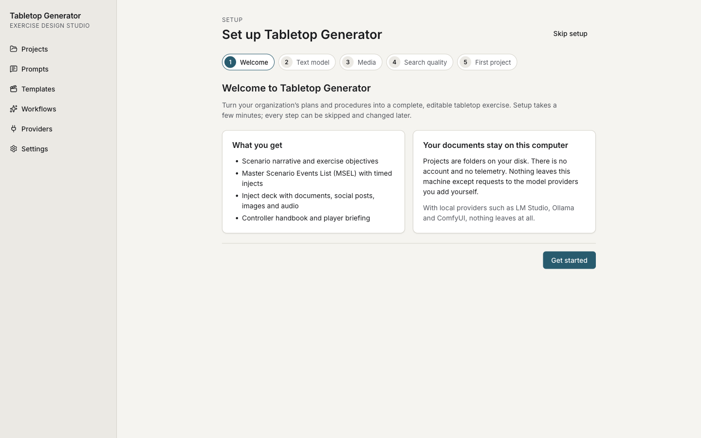

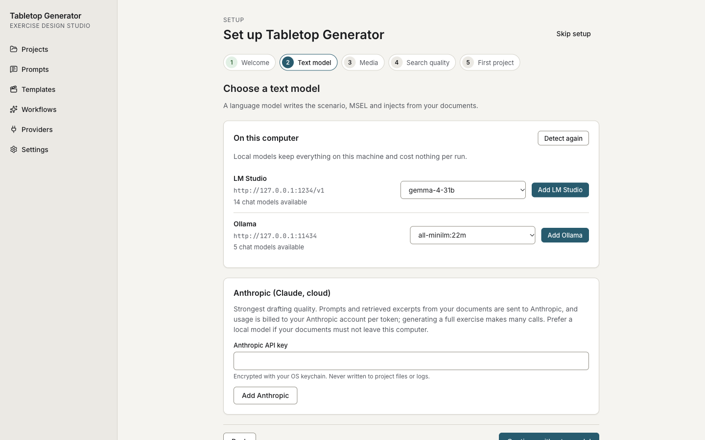

**Skip setup** goes straight to the Projects screen. You can run the wizard again from **Settings → Run setup again**. The rest of this guide shows the same steps on the regular screens, which is also where you change them later.

The sidebar has two parts: application screens (Projects, Prompts, Templates, Workflows, Providers, Settings) and, once a project is open, that project's screens (Overview, Documents, Generate, Scenarios, Facilitate, Search index, Prompt overrides, Provider routing).

## 2. Create a project

A project is a folder on disk that holds one organization's documents and every exercise built from them. You can copy it, back it up or put it under version control.

Click **New project** and fill in:

- **Project name**: also used for the folder name (`<name>.ttxproj`).
- **Organization**: the name as it should appear in briefings and injects.
- **Domain**: the kind of organization (a domain profile, ADR-0014): Airport, Transit (bus / rail), Dam / water authority, Water utility, Energy utility, Healthcare, Campus, Stadium / venue, Port / maritime, Municipal government, Industrial / manufacturing, Unmanned systems operator or Generic organization. Type in the search box (`bus`, `dam`, `hospital`, `drone`) to narrow the list, then click a profile or move with the arrow keys. The profile sets the vocabulary, the facility-fact categories, typical roles and outside parties, and the threat families the generator offers. Projects created before profiles existed keep their stored value; the picker says which profile it resolves to (for example _Saved as “hospital”, which uses the Healthcare profile_).
- **Location**: the parent folder (**Choose…** opens a folder picker). Set a default under **Settings → Default projects folder**.


**Create project** opens the project's **Overview**. The same domain picker is under **Organization**; below it, **Customize vocabulary** edits this project's player roles, outside parties, IT systems and OT / control systems as chip lists (type and press Enter to add, **×** to remove). A list you change replaces the profile's list for this project only; **Reset to … defaults** removes your changes. Fill in **Brand and locale** (city, region, primary colour) and **Aliases** (for example `orgShort` → `NCIA`, `localTv` → `Channel 5`): inject templates read these instead of hard-coding names. **Default roles** pre-fills the player roles of new scenarios. Click **Save settings**.

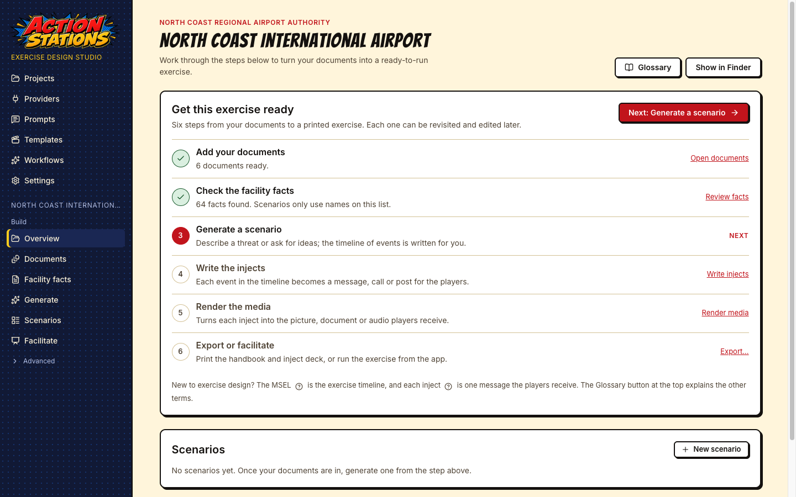

### Example projects

**Projects → Examples** lists ready-made projects built from fictional organizations' documents, each with its domain, a summary and its scenarios (with their threat families). **Open a copy** asks where to put the copy (default: your projects folder, else `Documents/Tabletop Generator`), copies the example into a new folder (never over an existing one: a second copy gets `-2`), and opens it. The example as shipped is never changed. A project opened from an example shows the example's notice at the top of every project screen. The search index is not shipped; it is rebuilt from the documents when the copy opens, as it is for any project folder opened without `index.sqlite` (a duplicate, or a folder from version control). The setup wizard's **First project** step offers the same examples under **Or explore an example**.

The project folder contains `project.json`, `documents/`, `scenarios/`, `prompts/` (project prompt overrides), `index.sqlite` (the search index), `ideas.json` and `facility-facts.md` (see [Facility facts](#facility-facts)). Its `.gitignore` excludes the search index and caches, which can be rebuilt.

## 3. Import documents

Open **Documents** and click **Import documents…**, or drop files anywhere on the window. PDF, Word, PowerPoint, Excel, Markdown, HTML, plain text and images (with OCR) are supported. Each file is copied into the project's `documents/` folder, parsed into heading-aware sections and indexed. For this walk-through, import the six Markdown files in `reference/ncia/` and `reference/ics-forms/`.


Measured: the six NCIA documents imported and indexed in 0.4 seconds (142 sections).

For each document, check:

- **Title** and **Short name**: citations read as `<short name> › <section>`, for example `TIRP › Section 13 › 13.6`. Click a title or short name to edit it.
- **Kind**: plan, policy, map, form, course, prior exercise or other.
- **Status**: **Indexed** when the document is searchable.

The **Embeddings** line shows the index's embedding mode (with this project's Embeddings routing when it overrides the global one). The default, **Keyword hashing**, works offline with no download; see [Embeddings](providers/README.md#embeddings) for the other modes and their current limits. After changing the mode, click **Rebuild index**.

### Facility facts

After every import or **Rebuild index** the app writes `facility-facts.md` in the project folder: the runways, taxiways, gates, concourses, rooms and areas, equipment, hostnames, IP ranges, phone numbers and agencies your documents state, one `## Section` per category and one `- ` bullet per identifier. Generation hands this list to the model as the only real identifiers, and the MSEL check flags rows that name a runway, taxiway, gate or concourse that is not in it (unless the row frames it as the attacker's fake data).

Open **Facility facts** in the project sidebar to correct the list. Each category is a section; every entry shows whether it came **From documents** (with where it was found, for example _Airport Emergency Plan › 2.2 Scope_) or was **Added by you**.

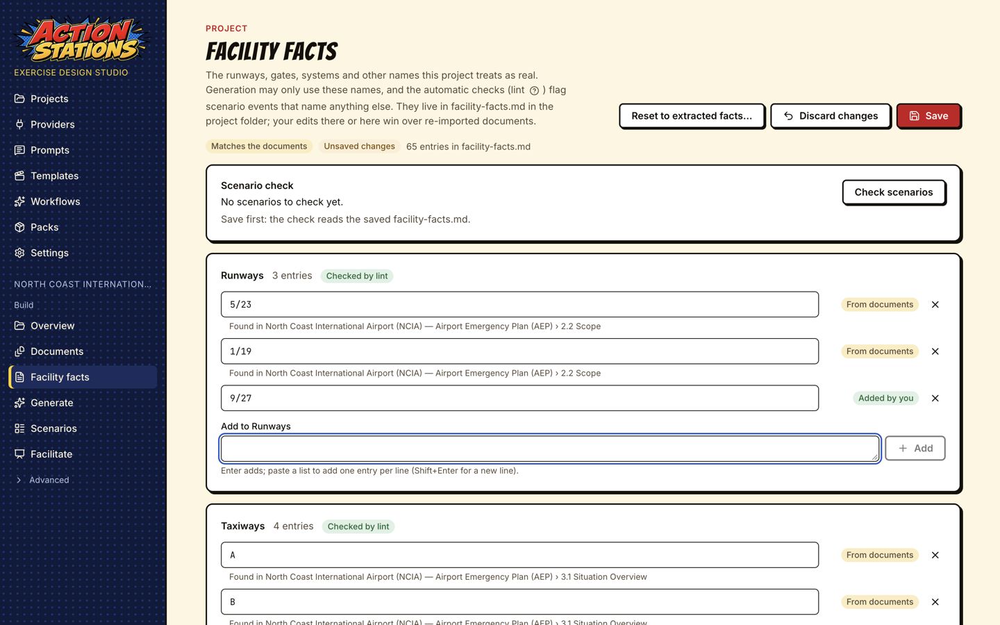

- **Add** what the extraction missed, for example a runway that only appears on an image-only map: type `9/27` in **Add to Runways** and press Enter. Paste a list to add one entry per line. Rows naming Runway 9 or 27 are then accepted.
- **Edit or remove** what is wrong, for example a gate range that belongs to the perimeter fence rather than the terminal: change the entry, or press **×** (or Backspace in an empty entry). Extracted entries you removed are listed under the section with **Restore**. Rows naming a removed gate are then flagged.
- **Add a category** under **Add a category** (for example _Pump stations_); its entries are shown to the model but not linted. Only categories marked **Checked by lint** produce warnings.

**Save** (or Ctrl+S / Cmd+S) writes `facility-facts.md`; **Discard changes** goes back to the saved file. After every save the **Scenario check** re-lints the project's scenarios and says how many unknown-identifier warnings (FACILITY_UNKNOWN_ID) there are now compared with when you opened the screen; **Check scenarios** runs it again, and each scenario's **Warnings** tab shows the rows.

You can also edit `facility-facts.md` in any text editor: one `## Section` per category and one `- ` bullet per entry. If the file changes on disk while the screen has unsaved edits, Save is refused and the screen offers to reload the file.

Your edits win. Once you have changed the file, importing more documents no longer overwrites it; the fresh extraction is written to `facility-facts.generated.md` next to it, and the screen lists what it found that your list lacks. To start over from the documents, click **Reset to extracted facts** and confirm. Every save and reset first keeps the previous file in `.cache/facility-facts-history/` (the last 20 versions; the project's `.gitignore` excludes `.cache/`).

## 4. Search the plans

Open **Search index** and try the systems your exercise should test, for example `FIDS failure manual announcements`. This is the same hybrid search (keyword plus vector, fused by rank) that every generation stage uses to retrieve and cite sections, so it shows what the generator will find.


Here the top hit is `TIRP › Section 13 › 13.6 Scenario C: FIDS / BHS System Failure`, followed by AEP Appendix 6. If a section you care about does not come up, retitle the document, check that it was parsed with its headings, or add the plan's own wording to your brief.

## 5. Connect a model

Generation needs a text model. If you set one up in the wizard, skip to step 6. This walk-through uses LM Studio; see the [provider guides](providers/README.md) for [LM Studio](providers/lm-studio.md), [Ollama](providers/ollama.md), [Anthropic](providers/anthropic.md), [ComfyUI](providers/comfyui.md) and [local TTS](providers/local-tts.md).

1. Start LM Studio's server and load a model with at least 32K context:

   ```bash
   lms server start
   lms load qwen/qwen3-30b-a3b-2507 --identifier qwen3-30b-a3b-2507 --context-length 32768 -y
   ```

2. In the app, open **Providers** and click **Detect local services**. It looks for LM Studio, Ollama and ComfyUI on this computer only. Click **Add** next to LM Studio.

   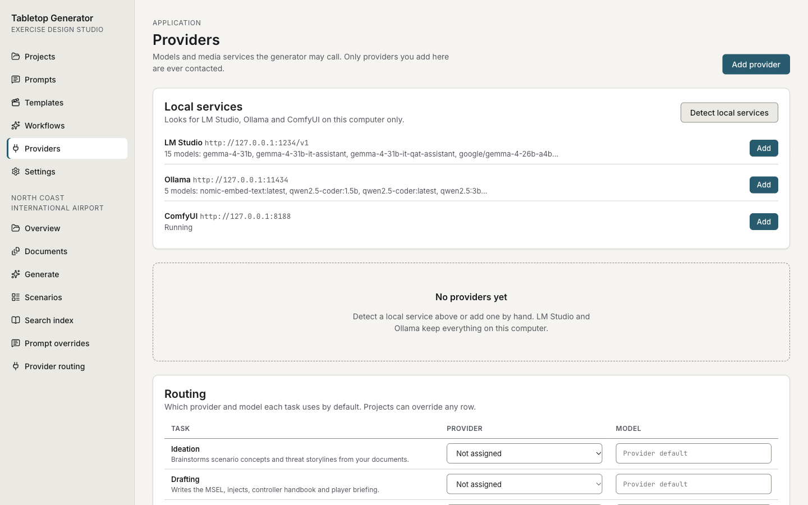

3. On the LM Studio card, click **Edit** and set **Default model** to `qwen3-30b-a3b-2507` (detection picks the first model alphabetically). Click **Test**: it should answer "OK" in well under a second.
4. In **Routing**, set **Ideation**, **Drafting** and **Critique** to LM Studio.

   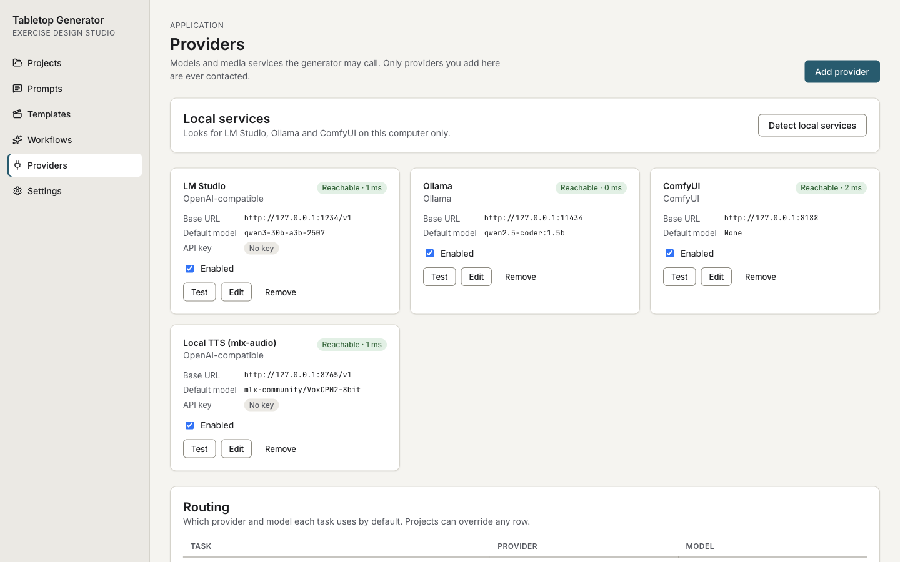

A project can override any routing row on its own **Provider routing** page.

## 6. Ask for ideas

Open **Generate** and choose **Give me ideas**. Optionally type a focus ("insider threat", "baggage systems, severe weather plus a cyber twist"), choose how many ideas (1 to 12), and click **Give me ideas**.

The model reads the sections retrieved from your plans and proposes distinct concepts, each with a hook, the threat, the systems affected, why it teaches, suggested roles, a difficulty, and the plan sections it exercises (as citation chips).

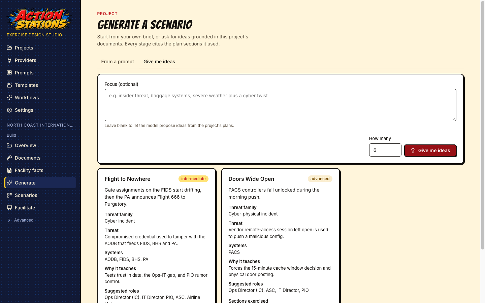

Measured: 4 ideas in 13 seconds.

## 7. Generate the scenario

Click **Develop this** on an idea. The **From a prompt** tab opens with the brief filled in from the idea: threat or theme, audience roles, duration, number of phases, start time, learning objectives, and constraints (the plan sections it must test). Edit anything, then click **Generate scenario**.

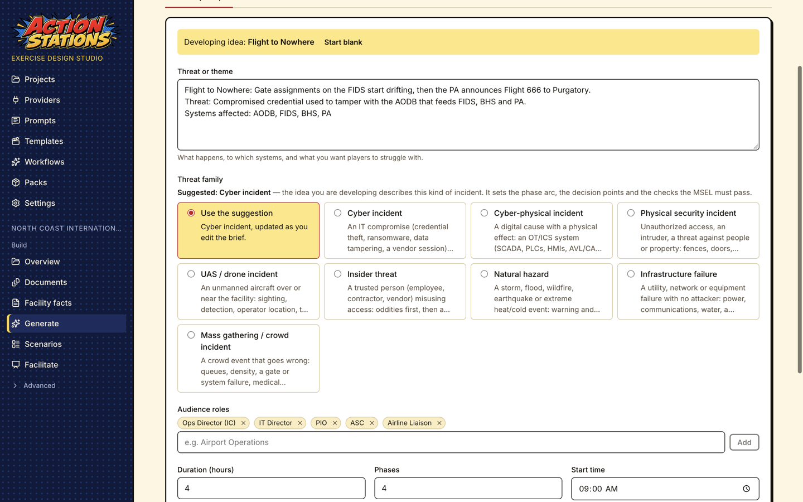

You can also start from **From a prompt** without an idea: describe the threat, list the roles and constraints, and generate.

**Threat family** sets the phase arc, the decision points and the lint checks of the scenario (cyber, cyber-physical, physical security, UAS / drone, insider, natural hazard, infrastructure failure, mass gathering; only the families the project's domain supports are listed). It starts on **Use the suggestion**, which shows the family the generator would pick and why: the idea you are developing, words in the brief (_the brief mentions “drone”_), or the domain's default. The suggestion updates as you edit the brief. Choose a family to override it; your choice is what the scenario gets. Idea cards show each idea's threat family too.

The scenario page opens and follows the run. **Stages** lists each completed stage with its model, tokens and duration; the **Generation log** streams progress and each stage's raw output.

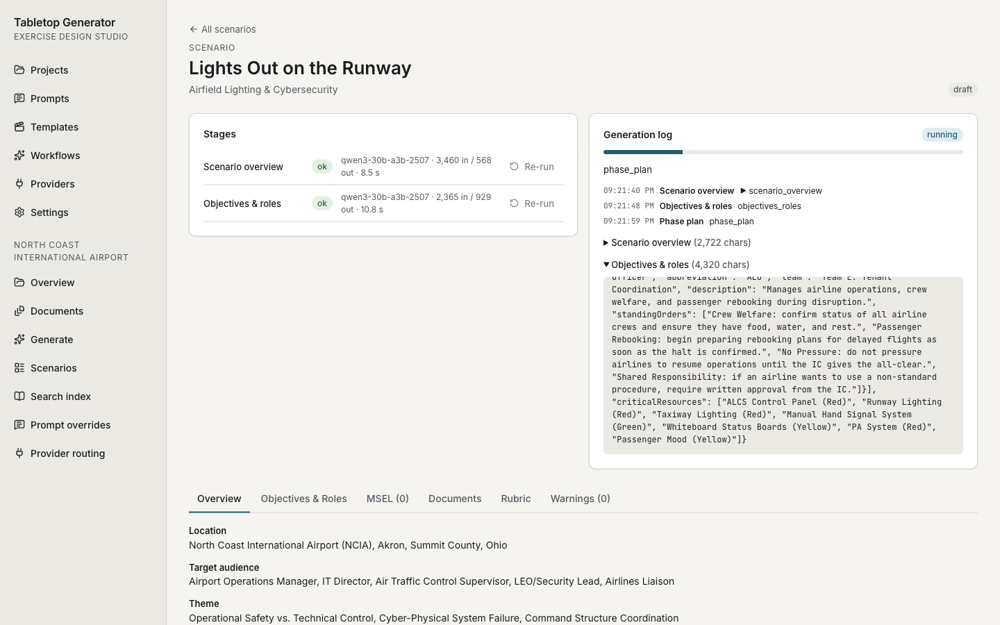

The stages run in this order: scenario overview, objectives & roles, phase plan, one MSEL phase per exercise phase, controller handbook, rubric, player briefing, hot wash, critique, and a revision pass over the MSEL phases using the critique. You can leave the page; the job keeps running and the page picks it up again.

Measured with `qwen3-30b-a3b-2507` on Apple Silicon: 340 seconds end to end, MSEL phases of 21,000 to 29,500 input tokens each.

## 8. Read and edit the result

When the run finishes, the status badge changes to **ready**.

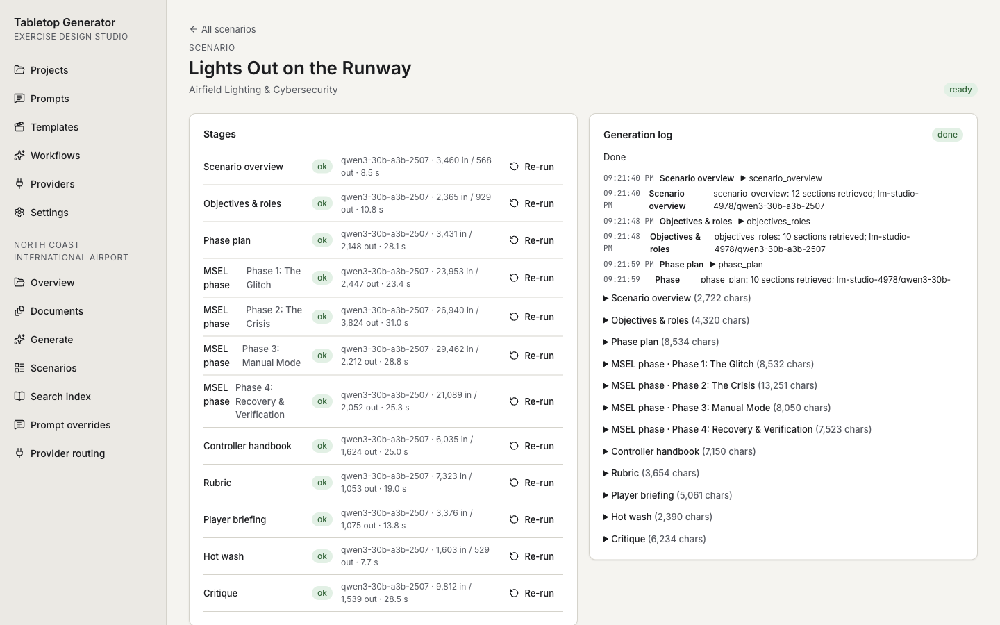

The tabs under the stages hold the scenario, and every tab is editable:

- **Overview**: location, audience, theme, threat, operational impact and the core plan sections tested.
- **Objectives & Roles**: exercise objectives, player roles with their standing orders, critical resources, and the SimCell scripts.
- **MSEL**: the grid editor (below).
- **Injects**: the inject deck, one card per MSEL row (below).
- **Documents**: the **Controller handbook**, **Player briefing**, **Hot wash guide** (with its structured questions) and the **MSEL document**, each in a document editor (below).
- **Rubric**: grading metrics with points and Fail / Pass / Excellence behaviours, linked to injects.
- **Warnings**: deterministic lint findings (for example a role with no inject in a phase) and the critique's findings, each pointing at a row.

  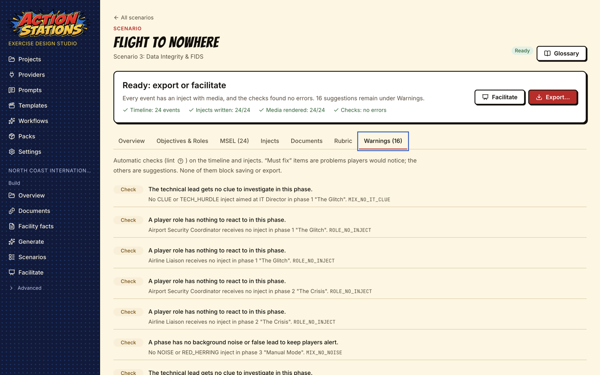

Everything is stored in `<project>/scenarios/<id>/`: `scenario.json`, the idea it was developed from (`idea.json`), and the handbook, briefing and hot wash as Markdown under `documents/`. The **Scenarios** page lists every scenario in the project.

### The MSEL editor

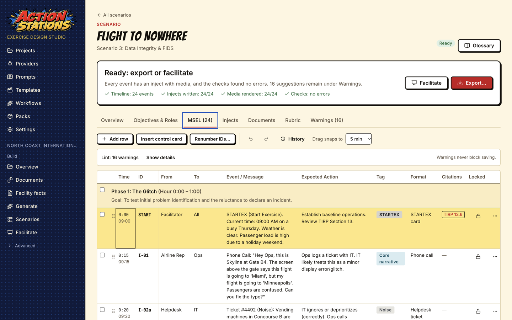

- Click a cell, or move with the arrow keys, Home/End and Page Up/Down; **Enter** edits and saves the cell, **Tab** moves on, **Esc** cancels.
- **Add row** and **Insert control card** (a time jump) add rows; drag a row by its handle to retime it (**Drag snaps to** sets the step).
- Select rows with their checkboxes to **Shift times by** a number of minutes or **Move to** another phase.
- **Renumber IDs…** previews and applies `I-01`, `I-02`, … in time order; rubric links and the injects attached to each row follow the new IDs.
- Lock a row (padlock) to keep it when the MSEL stage is re-run.
- The lint bar shows the current warnings; warnings never block saving.
- Edits save automatically. **Undo**/**Redo** and **History** (saved snapshots you can restore) are in the toolbar.

### The document editors

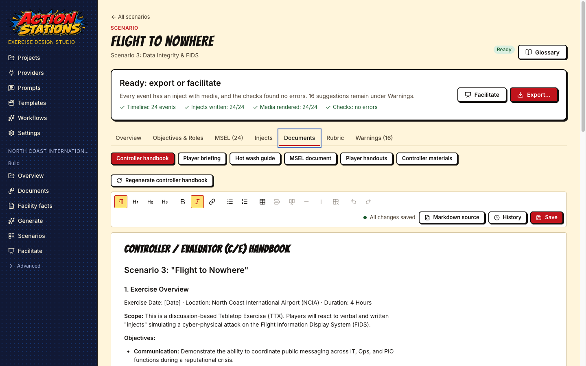

Each document has a formatting toolbar, a **Markdown source** toggle, autosave plus **Save**, and **History** with a diff against the current text and **Restore**. **Regenerate …** re-runs the stage that writes the document, with optional instructions; if you have edited the document, it asks first and keeps a history snapshot of your version.

### Injects and media

The **Injects** tab shows the deck: one card per MSEL row in time order, with a thumbnail of the rendered inject, its type, purpose tag, recipient, and badges for audio, video, warnings and locks. Filter by phase, purpose, type or media.


- **Write all injects** runs the inject text stage for every row: it picks the inject type (a tweet, a helpdesk ticket, a FIDS board, a radio call transcript, ...) and fills that template's fields from the MSEL row and the plans. Progress is shown per inject, and the job can be cancelled.
- **Render all media** renders every inject: template pages as PNG (and PDF for paper injects), plus AI photos and clips through ComfyUI and voice through text-to-speech where the inject calls for them and those providers are routed (see the [provider guides](providers/README.md)).

Click a card to open the **inject editor**. From the keyboard the deck is one Tab stop: the arrow keys move between cards (Up/Down by a row), Home/End jump to the first/last card, and **Enter** opens the inject (or **Create…** for a row without one).

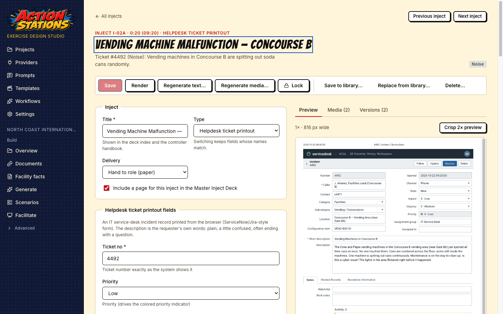

- The left side is a form built from the template's schema: title, type (switching keeps fields whose names match), variant (saved with the inject and used by Render and export), delivery (hand to a role, show on the main screen, play audio, read aloud), whether it gets a page in the Master Inject Deck, then the template's own fields.
- The right side has a live **Preview** (fast 1× or crisp 2×; image slots show the inject's own AI images, or the template's sample images when it has none), **Media** with each file's provenance (provider, model, prompt, seed, workflow or template version), and **Versions**, with a diff and **Restore**.
- The toolbar has **Save** (Cmd/Ctrl+S), **Render** (Cmd/Ctrl+Enter saves and renders), **Regenerate text…** and **Regenerate media…** (with optional instructions; regenerated fields are shown as changes before you keep them), **Lock**, **Save to library…**, **Replace from library…** and **Delete…**. **Previous inject** and **Next inject** walk the deck.
- A locked inject cannot be edited or regenerated until you unlock it.

### While generation is running

A scenario runs one generation job at a time. While it runs, your edits to that scenario are kept in the editor and a banner says "Generation is running for this scenario"; they are saved automatically when the job finishes. If you leave a tab or document before such a save goes through, the edit is kept: the scenario page shows "1 unsaved change pending" and saves it when the job finishes, or the editor takes it back when you return. Field warnings from inject generation (`INJECT_FIELDS_INVALID`) are cleared when you save fields that match the template.

### Improve a stage

The **Stages** panel lists the latest run of each stage. Per-inject stages (inject text, media brief, media render) are grouped into one collapsible row per stage with ok/error/stale counts; a group with errors starts expanded. Each stage has **Re-run**. The dialog takes **Extra instructions** for that run only ("make the red herring more plausible; cite ASP 6.4"). Stages that depend on the re-run one are marked stale; locked MSEL rows are kept. If a stage fails, **Continue from failure** resumes from it. To change how a stage writes every time, edit its prompt: see the [prompts guide](prompts.md).


## 9. Run the exercise (facilitator mode)

Open **Facilitate** in the project sidebar and pick a scenario.

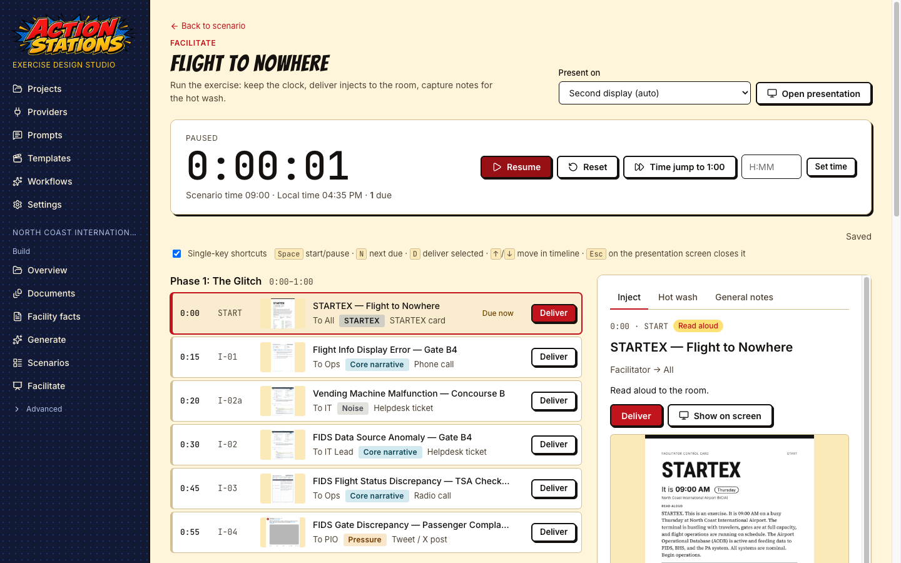

- **Exercise clock**: **Start**/pause (**Space**), **Reset**, **Time jump to** the next phase, or type a time (`H:MM`) and **Set time**. The scenario's wall-clock time is shown under it.
- **Timeline**: every MSEL row by phase; rows whose time has come are marked **Due now**. **N** selects the next due row, the arrow keys move through the timeline, and **Deliver** (**D**) records when it was handed over.
- The single-key shortcuts (**Space**, **N**, **D**) can be switched off with **Single-key shortcuts** next to the key list (useful with speech input or a screen reader). They never fire while you type, and **Space** on a focused button presses that button.
- **Show on screen** opens the inject's media full-screen on the display chosen in **Present on** (a second display by default); **Esc** on that screen closes it.
- The side panel has three tabs: **Inject** (event, expected action, instructor note, and a hot wash note for that inject), **Hot wash** (the rubric, the hot wash questions and all inject notes) and **General notes**.

The clock, delivered injects and notes are saved in `<project>/scenarios/<id>/facilitator.json`, so a session survives a restart.

## 10. Export the exercise

Click **Export** on the scenario page.

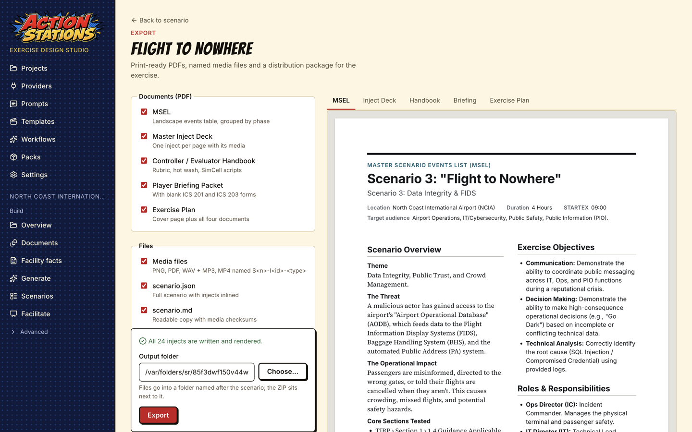

Choose what to export:

- **Documents (PDF)**: **MSEL** (landscape events table by phase), **Master Inject Deck** (one inject per page with its media), **Controller / Evaluator Handbook** (with rubric, hot wash and SimCell scripts), **Player Briefing Packet** (with blank ICS 201 and ICS 203 forms) and the **Exercise Plan** (a cover page plus all four documents).
- **Files**: **Media files** (PNG, PDF, WAV and MP3, MP4, named `S<n>-I<id>-<type>`), **scenario.json** (the full scenario with injects inlined), **scenario.md** (a readable copy with media checksums), **Word documents** (handbook and player briefing as `.docx`) and the **Distribution ZIP** (`facilitator/` with everything, `players/` with the briefing and forms).

The right side previews each PDF before you export. Pick an **Output folder** and click **Export**: files go into a folder named after the scenario, and the ZIP sits next to it.

Measured on the Scenario 3 deck (24 injects): every target exported in 5.9 seconds, 54 files including a 20.6 MB distribution ZIP.

## Keyboard, screen readers and zoom

Everything in the app works from the keyboard. **Skip to main content** is the first Tab stop; after you follow a link, focus moves to the new page's heading and the window title names the page. Dialogs keep focus inside until you close them (**Esc**), then return it to the button that opened them. Below about 830 px of width (for example a 1280 px window at 200 % zoom) the sidebar folds behind a **Menu** button. Long jobs (ingest, index rebuilds, model downloads, generation, export) show progress with a **Cancel** button, announce progress to screen readers without flooding them, and failures say what went wrong and what to try next, with **Retry** where it applies. Colors meet WCAG AA in light and dark (`node scripts/check-contrast.mjs` checks every token pair the stylesheets use).

## Next steps

- [How a good tabletop exercise is built](methodology.md): what the generator is aiming for.
- [Prompts](prompts.md): change how any stage writes.
- [Providers](providers/README.md): other models, cloud models, images, video and voice.
- [Templates](templates.md): add or change inject templates.
