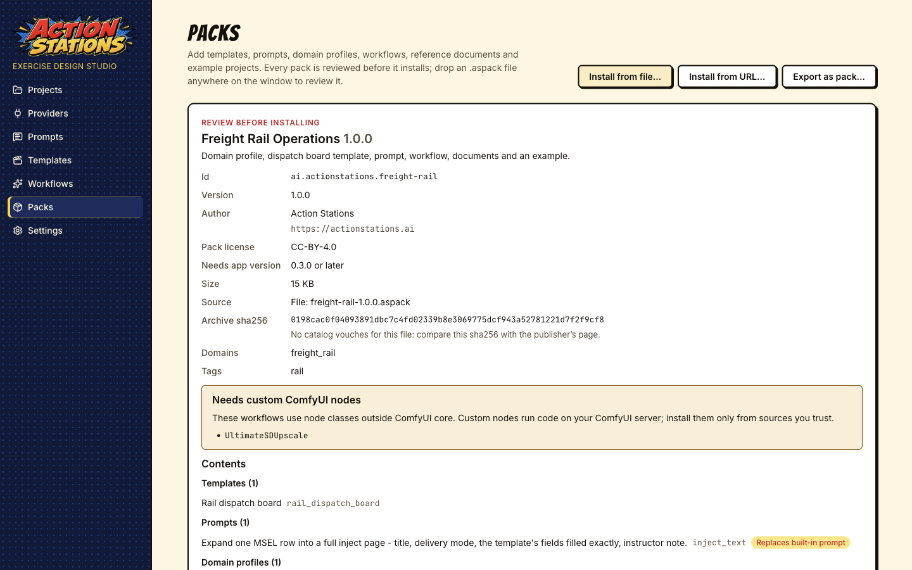
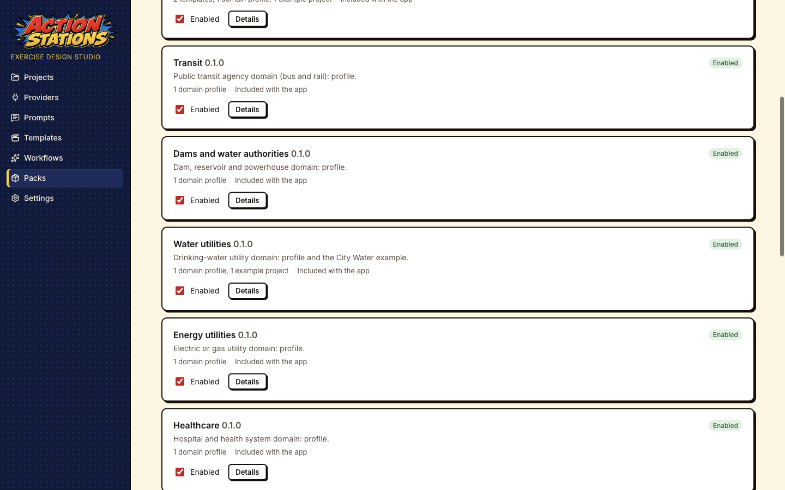
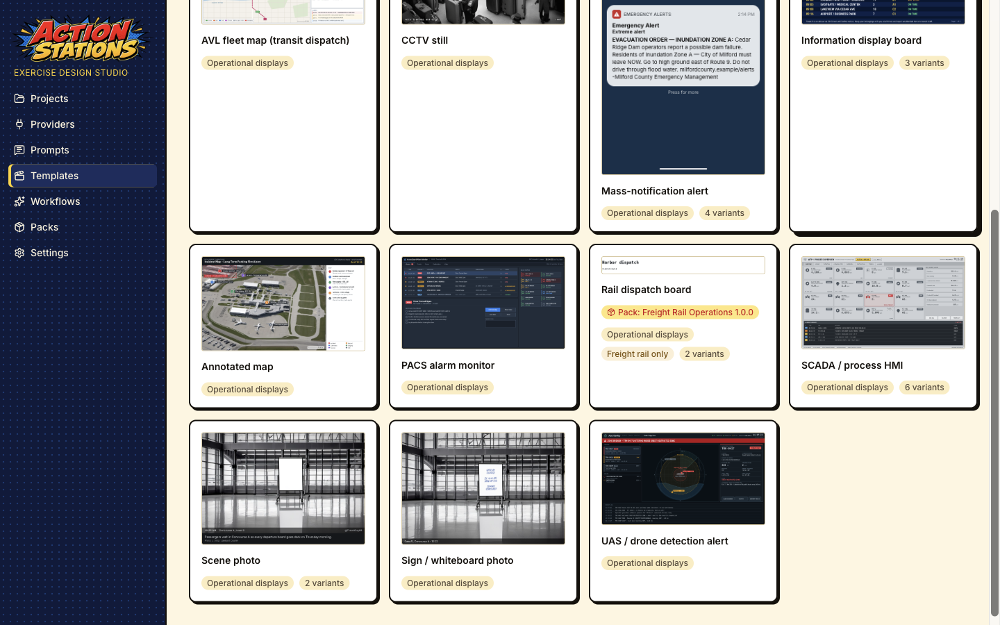
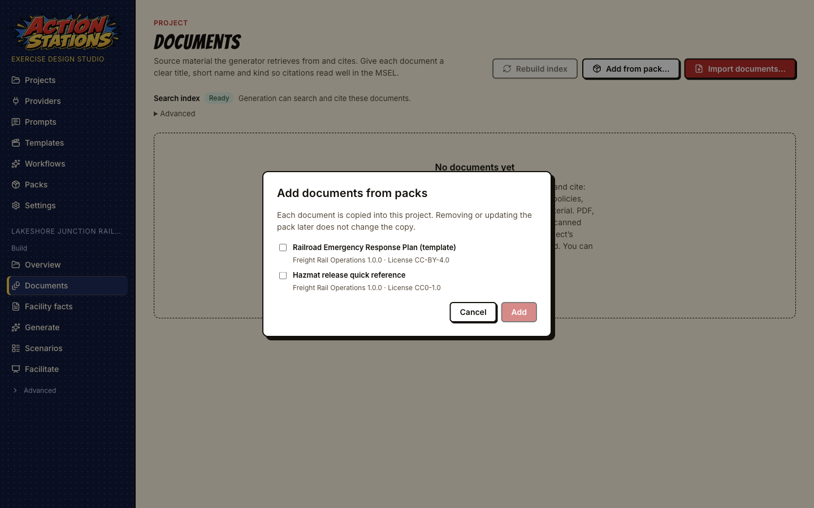
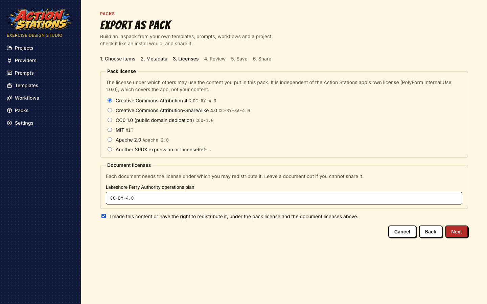

# Packs guide

A pack is a single `.aspack` file that adds content to Action Stations: inject templates, prompts, domain profiles, ComfyUI workflows, reference documents and example projects. This guide covers installing packs, reading the review before you install, what happens to your projects when a pack is updated, disabled or removed, exporting your own work as a pack, and validating a pack from the command line.

The file format is specified in [docs/packs-format.md](../packs-format.md) and the design decisions in [ADR-0018](../adr/0018-packs.md). The screenshots are taken from the built app by `e2e/packs.spec.ts` (`pnpm build:app && GUIDE_SHOTS=1 pnpm exec playwright test e2e/packs.spec.ts`) with mock providers, an isolated data folder and the test fixture pack **Freight Rail Operations**.

## What a pack contains

| Kind                | What it adds                                                                                     | Where you see it                                       |
| ------------------- | ------------------------------------------------------------------------------------------------ | ------------------------------------------------------ |
| Templates           | Inject templates, including new inject types.                                                    | **Templates**, inject type lists in the MSEL and deck. |
| Prompts             | Replacements for the prompts the app ships, for projects in the pack's domains.                  | **Prompts**, and the project's generation.             |
| Domain profiles     | A new kind of organization (freight rail, a port, a water utility) with its systems and threats. | The domain picker on **New project** and **Overview**. |
| ComfyUI workflows   | Image and video workflows with their bindings.                                                   | **Workflows**.                                         |
| Reference documents | Plans, templates and quick references you can copy into a project.                               | **Documents → Add from pack…**                         |
| Example projects    | Ready-made fictional projects.                                                                   | **Projects → Examples**.                               |

A pack carries data only. It cannot contain programs, scripts or plugins (see [Security](#security)).

## The Packs screen

Open **Packs** in the sidebar. **Installed** lists what you have; **Browse** lists the packs in the catalogs you added. **Install from file…**, **Install from URL…** and **Export as pack…** are at the top right.


Nothing is contacted until you add a catalog. The app ships with no catalog, never checks for packs at startup or in the background, and fetches a catalog only when you open **Browse** or press **Refresh**. An archive is downloaded only when you choose to review it for installing.

## Install a pack

Every way of installing ends on the same review page, and the **Install** button exists only there. Opening or dropping a file never installs it.

### From a catalog

A catalog is a list of packs published on a web site. To add the official one:

1. **Packs → Browse**. With no catalogs, Browse shows the **Pack catalogs** settings (also in **Settings**).
2. Press **Add the official catalog (actionstations.ai)**, or paste another catalog's address into **Catalog URL** and press **Add catalog**. Addresses must use `https`.

   

3. Browse fetches the catalog and lists the newest version of each pack, with filters for search text, kind, domain and tag. **Refresh** fetches again; **Manage catalogs** opens Settings, where you can remove a catalog. A catalog that fails to load is listed with its error, and the last copy that loaded is still shown.
4. Press **Review and install** on a pack. The archive downloads as a background job, its sha256 is checked against the catalog, and the review opens.

### From a file

Press **Install from file…** and pick an `.aspack` file, drop the file anywhere on the app window, or open it from Finder or Explorer. Each of these opens the review.

### From a URL

Press **Install from URL…**, paste the archive address (`https`), and if the publisher lists a sha256, paste it into **Expected sha256 (optional)**. **Download and review** downloads the archive; a download whose sha256 differs from the one you entered is refused.

### Running from source before 0.3.0

Pack support ships in 0.3.0, and packs state the oldest app version they need (`minAppVersion`, in practice `0.3.0`). Until the app's own version reaches 0.3.0, a development build reports an older version and refuses those packs with "This pack needs Action Stations 0.3.0 or later". To try packs from a source checkout, start it with `TTX_APP_VERSION=0.3.0 pnpm dev`. The variable is ignored in packaged builds.

## Read the review

The review shows everything the pack would add before anything is installed.



- **Id, version, author, homepage, size and source**: where the file came from (a catalog, a URL or a file name).
- **Pack license**: the license of the pack's own content. It is chosen by the pack author and is separate from the app's license.
- **Needs app version**: the oldest app version the pack works with.
- **Archive sha256**: see [What the hashes prove](#what-the-hashes-prove).
- **Domains**: the domain profiles the pack is for. A pack's prompts only apply to projects in these domains.
- **Needs custom ComfyUI nodes**: the pack's workflows use node classes that are not part of ComfyUI itself. Custom nodes run code on your ComfyUI server. The pack does not install them; you install them in ComfyUI yourself, so get them only from sources you trust. A workflow without its nodes fails in ComfyUI; nothing else in the pack is affected.
- **Contents**: every item by kind. **Replaces built-in template** (or prompt, or workflow) means the pack's version will be used instead of the one the app ships.
- **Document licenses**: the title, source and license of every reference document. Check them before you share anything made from those documents.
- **Conflicts**: another enabled pack already provides an item with the same id. The pack then installs disabled, with a note such as "Disable Freight Rail Operations to enable this pack".

At the bottom, the button says what will happen: **Install**, **Reinstall** (same version), **Update to 1.1.0**, or **Downgrade to 1.0.0**, which also needs the box **Replace the installed … with the older …** ticked. **Cancel** installs nothing.

If the archive fails a check, the page is titled **This pack cannot be installed** and lists each problem with the file inside the pack it concerns. Nothing is installed.

### What the hashes prove

`pack.json` lists the sha256 and size of every file in the pack, and the app refuses a pack in which any file differs, is missing, or is not listed. A catalog entry also lists the sha256 of the whole archive, and a download that does not match it is refused.

That proves the files are the ones the pack's manifest (and the catalog, if you installed from one) describes: nothing was damaged or swapped in transit or on a mirror. It does not prove who made the pack, and it does not make the content safe or accurate. Packs are not signed. Trusting a catalog means trusting whoever runs it. For a file or URL with no catalog behind it, the review says "No catalog vouches for this file: compare this sha256 with the publisher's page".

## Installed packs



Each installed pack shows its version, counts by kind and source, a status (**Enabled**, **Disabled**, **Conflict** or **Broken**) and:

- **Enabled**: turn the pack on or off. A disabled pack keeps its files but adds nothing to the app.
- **Details**: the id, author, license, install time, archive sha256 and every item.
- **Uninstall**: removes the pack after a confirmation.
- **Update available: 1.1.0** and **Review update to 1.1.0** appear when a catalog you added lists a newer version. Updates are worked out from the last catalog fetch, without going online. The update goes through the same review.
- **Check files** re-hashes every installed file. At startup the app also checks each pack, and a pack whose files changed on disk is shown as **Broken** and not loaded; reinstall it to repair it.

Installed packs live in the app's data folder, `userData/packs/<id>/<version>/`, with the files read-only. One version of each pack is kept.

## Using pack content in a project

Pack items show a badge naming the pack, for example **Pack: Freight Rail Operations 1.0.0**, on the Templates, Prompts and Workflows screens, in the domain picker, in the inject type lists and on example projects.



### Projects keep their own copies

So that a project keeps working when a pack is updated, disabled or uninstalled, or when you share the project with someone who does not have the pack, the project copies what it uses:

- **Templates**: the first time an inject of a pack template's type is created, saved or rendered, the template is copied to `<project>/templates/injects/<type>/`.
- **Workflows**: the first time a pack workflow renders media for the project, it is copied to `<project>/comfy/workflows/`.
- **Domain profiles**: choosing a pack domain stores a copy of the profile in `project.json`.
- **Reference documents**: **Documents → Add from pack…** lists the documents of every enabled pack with their license. Tick the ones you want and press **Add**; each is copied into the project and indexed like any imported file.

  

- **Example projects**: opening an example copies it, as for the built-in examples.

Each copy is recorded in `<project>/packs.json` with the pack, version and file hashes. A copy shows a badge such as **From Freight Rail Operations 1.0.0**, plus:

| Badge                | Meaning                                                                                            |
| -------------------- | -------------------------------------------------------------------------------------------------- |
| **edited**           | The project's copy no longer matches what was copied. The app never overwrites it silently.        |
| **not installed**    | The pack is uninstalled or disabled. The project still uses its copy.                              |
| **Update available** | The installed pack is a newer version than the one the copy came from. The project keeps its copy. |

For a domain profile, the project's **Overview** shows when the installed pack has another version of the profile, with **Show changes** (field by field) and **Update profile from pack**. Nothing changes until you press it. Template and workflow copies show the badge but are not replaced from these screens: the project keeps rendering with its copy, and new projects get the pack's current version.

### Pack prompts are scoped by domain

Pack prompts are not copied. They apply while the pack is enabled, and only to projects whose domain is one the pack lists; a pack that lists no domains applies to every project. A rail pack's prompts do not change a hospital exercise. A global or project prompt override still wins over a pack prompt (see [Prompts → Layers](prompts.md#layers-default-pack-global-project)). Every generated output records a hash of the prompt it used.

### Update, disable, uninstall

| You…             | Pack items in the app                                                                     | Projects                                                                                                                                              |
| ---------------- | ----------------------------------------------------------------------------------------- | ----------------------------------------------------------------------------------------------------------------------------------------------------- |
| Update a pack    | The new version replaces the old one.                                                     | Copies stay as they were and show **Update available**. New projects and items not yet copied use the new version. Prompts change for new generation. |
| Disable a pack   | Its templates, prompts, workflows, domains, documents and examples are no longer offered. | Copies keep working and show **not installed**. Prompts fall back to the next layer (your override, or the app's default).                            |
| Uninstall a pack | The files and the record are removed.                                                     | Same as disable.                                                                                                                                      |

## Export and share a pack

**Packs → Export as pack…** builds a pack from your own work: templates in your user layer, global prompt overrides, your ComfyUI workflows, and from one project its domain profile (under a new id), its documents and the project itself as an example.

The wizard has six steps:

1. **Choose items**. For an example, give it an id, a title, a summary and a **Notice** (shown as a banner in every project opened from it, for example that the organization is fictional). Example projects are cleaned on export: provider settings, keys, tokens and local folder paths are removed, and a file that still looks like a key or a local path stops the export.
2. **Metadata**: name, pack id (reverse-DNS, for example `io.github.<your GitHub user>.<name>`), version, summary, description, author, domains and tags.
3. **Licenses**: choose the pack license (there is no default), give each document the license under which you may redistribute it, and confirm you have the right to share the content. Leave out any document you cannot share.

   

4. **Review**: the app builds the pack and checks it with the same reader an install uses. A pack that fails is listed with its problems and cannot be saved.
5. **Save**: **Save pack…** writes the `.aspack` where you choose.
6. **Share**: the file's sha256 and the steps to publish it.

   

To list a pack in the official catalog, open a pull request to the site repository: fork it on GitHub, add the file as `packs/files/<id>-<version>.aspack`, and paste the sha256 into the pull request description. **Open the contribution page** opens the repository in your browser; nothing is sent until you do this yourself. The maintainer validates the pack with the app's reader, checks the document licenses and rebuilds the catalog before merging. To share a pack privately, send the file and its sha256; the recipient installs it with **Install from file…** and compares the sha256 on the review.

## Validate a pack from the command line

Pack authors and catalog maintainers can run the app's own reader without starting the app (Node 20 or later, in a checkout after `pnpm install`):

```bash
node scripts/pack-validate.mjs my-pack-1.0.0.aspack
```

A valid pack prints `my-pack-1.0.0.aspack: ok (<id> <version>, <n> files, sha256 <hash>)`. Otherwise each problem prints on its own line with the file inside the pack it concerns, and the exit code is 1. Several files can be checked at once.

The `minAppVersion` check compares with the version in the checkout's `package.json`. Until that is 0.3.0, add `--app-version 0.3.0`, or packs that need 0.3.0 are refused:

```bash
node scripts/pack-validate.mjs my-pack-1.0.0.aspack --app-version 0.3.0
```

The script also prints a pack's catalog entry (`--catalog-entry --url <base-url>`) and checks a whole catalog (`--catalog index.json`); see [Publishing to the official catalog](../packs-format.md#publishing-to-the-official-catalog). Template authors can render a pack's template previews against their golden images with `pnpm test:templates --pack <unpacked pack folder>` (see [Template authoring](templates.md#sharing-a-template-in-a-pack)).

## Security

What a pack cannot do:

- **No programs.** A pack can only hold the file types its six kinds need (templates, Markdown prompts, JSON, documents, images, fonts and media). Scripts, executables, plugins, SVG images and any HTML other than a template's `template.html` are refused.
- **No files outside its folder.** Paths that could leave the pack's install folder, links, encrypted entries and archives over the size limits are refused before anything is written.
- **No changed files.** Every file must match the hash in `pack.json`, installed files are read-only, and the app re-checks them at startup.
- **No silent install or update.** Every install, update and downgrade goes through the review, and nothing is fetched except when you open Browse, press Refresh or start a download.

Templates get extra checks. A pack template is checked when it is installed and again every time it is loaded (so are your own and project templates, since projects are shared too): scripts, event handlers, remote addresses and similar constructs are refused, not cleaned up. Templates then render in a locked-down window without scripts or network access.

What remains your decision:

- **Custom ComfyUI nodes** that a pack's workflows need run code on your ComfyUI server. The pack cannot install them, but the workflows will not work without them; install them only from sources you trust.
- **Prompts** from a pack change what the model is asked to write for projects in the pack's domains. Read them on the **Prompts** screen if a pack's output surprises you.
- **Documents** from a pack are indexed and quoted to the model like any document you import.
- **Hashes are not signatures.** They show a pack was not altered after its manifest and catalog entry were written, not who wrote it. Install packs from catalogs and people you trust.
