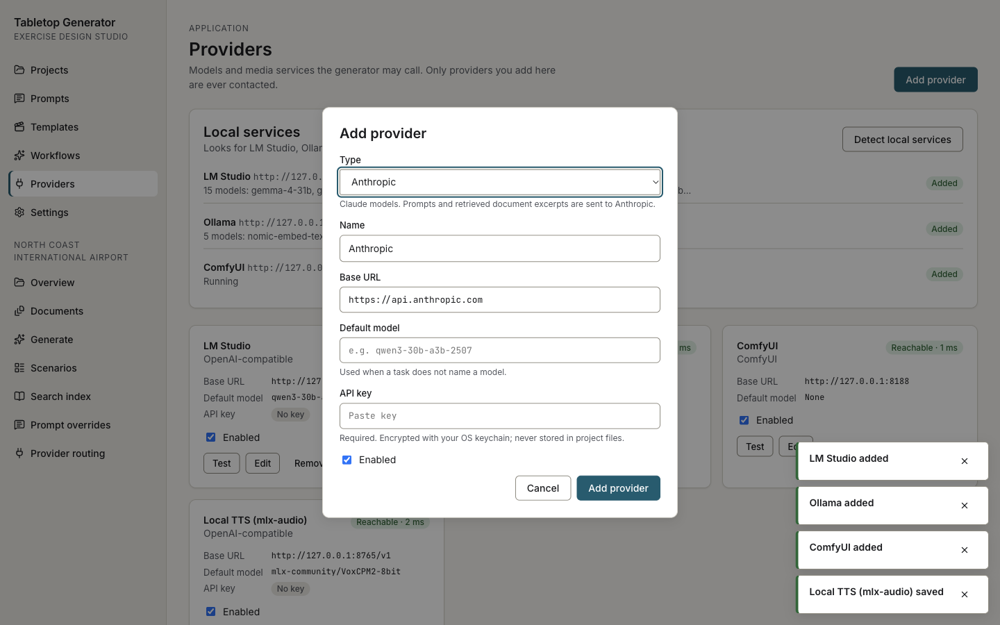

# Anthropic (Claude)

The Anthropic provider sends generation requests to Claude models through the Anthropic Messages API. It is the only provider in this list that leaves your computer: **prompts, retrieved excerpts of your documents and the scenario so far are sent to Anthropic** for every stage routed to it. Use project routing to keep sensitive projects on local models.

## 1. Get an API key

Create a key in the [Anthropic Console](https://console.anthropic.com) under **API keys**. Usage is billed per token to that account.

## 2. Add the provider

1. **Providers → Add provider → Type: Anthropic.** The base URL is fixed to `https://api.anthropic.com`.
2. Paste the key into **API key**. Leave **Default model** empty to use the app's default (`claude-opus-5-5`), or enter a model id such as `claude-sonnet-5-5` or `claude-haiku-5-5`.
3. **Add provider**, then **Test** on the card.
4. In **Routing**, assign the tasks you want Claude to run.

## How the key is stored

- The key is encrypted with the operating system's keychain (Electron `safeStorage`) and written as ciphertext to `secrets.json` in the app's data folder, with owner-only permissions.
- It is never written to `settings.json`, to a project folder, or to any log, and it is never sent to the app window: after saving, the form only shows that a key is set, with **Replace** and **Remove**.
- If the operating system cannot encrypt (for example Linux without a keyring, where Electron falls back to plain text), the app refuses to store the key.
- Removing the provider removes its key.

## Cost

Every Claude call is metered in `provider-calls.jsonl` in the app's data folder: model, input, output and cache tokens, duration, and an **estimated** cost from list prices built into the app (`src/main/providers/text/anthropic/models.ts`, cached 2026-10-06; prices change, so treat the figure as an estimate, not a bill). The retrieved document context is sent as a cacheable block, so repeated calls within a few minutes are billed at the cache-read rate.

For scale: the reference scenario generated on a local model used about 127,000 input and 21,500 output tokens across its stages (ideation and inject generation not included). At the built-in list prices that volume is roughly:

| Model               | Input / output per million tokens | One scenario (estimate, before caching) |
| ------------------- | --------------------------------- | --------------------------------------- |
| `claude-opus-5-5`   | $4 / $20                          | about $0.95                             |
| `claude-sonnet-5-5` | $2 / $10                          | about $0.47                             |
| `claude-haiku-5-5`  | $0.10 / $0.50                     | about $0.02                             |

Claude's tokenizer counts differently from the local model's, re-running stages adds to the total, and inject generation adds one call per inject. Check `provider-calls.jsonl` after a run for the real figures.

A cost-conscious setup: local models for ideation and drafting, Claude for critique only (one call per scenario plus the MSEL revisions).

## Options

Set in the provider's `options` in `settings.json` (see [Advanced provider options](README.md#advanced-provider-options)): `effort` (default `high`), `maxTokens`, `timeoutMs`, `anthropicVersion`, and `fallbacks` (`false` disables server-side model fallbacks).

## Troubleshooting

| Symptom                                     | Fix                                                                                                                     |
| ------------------------------------------- | ----------------------------------------------------------------------------------------------------------------------- |
| **Test** fails with an authentication error | The key is wrong or revoked. **Edit → Replace** the key.                                                                |
| "The OS cannot encrypt" / key not saved     | No usable keychain (common on minimal Linux). Install and unlock a keyring (GNOME Keyring or KWallet), restart the app. |
| Rate-limit or overloaded errors             | The app retries transient errors. If they persist, route fewer tasks to Claude or wait.                                 |
| Cost figure missing in the call log         | The model id is not in the built-in price list; the call still works.                                                   |
