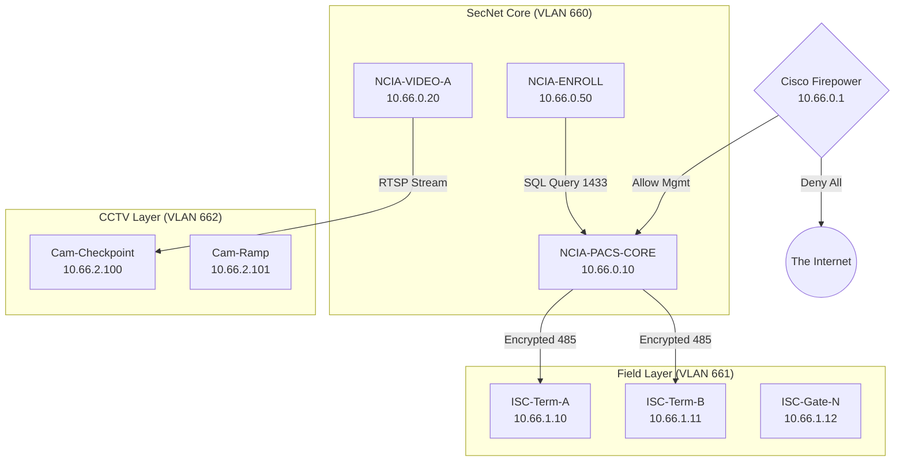

# North Coast International Airport (NCIA) — Airport Security Program (ASP)

TSA Approval Date: 09/01/2024 · Revision Number: 4.5 · Classification: SENSITIVE SECURITY INFORMATION (SSI) *(fictional marking for classroom use)*

> **Fictional document** created for the CSAAP course. The SSI warning below is reproduced as part of the teaching artifact; nothing here is real SSI.

**WARNING: SENSITIVE SECURITY INFORMATION.** This record contains Sensitive Security Information that is controlled under 49 CFR parts 15 and 1520. No part of this record may be disclosed to persons without a "need to know," as defined in 49 CFR parts 15 and 1520, except with the written permission of the Administrator of the Transportation Security Administration or the Secretary of Transportation. Unauthorized release may result in civil penalty or other action.

## Table of Contents
Section 1 General Provisions & Administration · Section 2 Security Areas (SIDA, Secured, AOA) · Section 3 Access Control Systems · Section 4 Personnel Identification (Badging) · Section 5 Law Enforcement Support · Section 6 Contingency Plans · Section 7 Tenant Security Programs · Attachments A–C · Appendices D (Security Systems Architecture), E (Access Control Failure Modes), F (Cyber-Security Controls)

---

## SECTION 1: GENERAL PROVISIONS AND ADMINISTRATION

### 1.1 Purpose and Authority (49 CFR § 1542.101)
The North Coast Regional Airport Authority (NCRAA), the "Airport Operator," has established this ASP to describe the security measures required to comply with 49 CFR Part 1542: to provide for the safety and security of persons and property on aircraft against acts of criminal violence, aircraft piracy, and the introduction of deadly or dangerous weapons, explosives, or incendiaries. This ASP details systems, measures, and procedures to prevent unauthorized access to the AOA, Secured Area, SIDA, and Sterile Area; provide for safety and security within the terminal and perimeter; and define responsibilities of the Airport Operator, Aircraft Operators, Tenants, and Law Enforcement.

### 1.2 Airport Security Coordinator (ASC) (49 CFR § 1542.3)

| Designation | Name | Title | 24/7 Contact | Email |
|---|---|---|---|---|
| Primary ASC | Michael T. Chen | Director of Public Safety / Security | (330) 555-0911 (Operations Center priority line) | mchen@ncia.aero |
| Alternate ASC | Sarah Jenkins | Airport Operations Manager | (330) 555-0912 | |

Responsibilities: immediate corrective action for any non-compliance; review all security-related functions; liaison with the TSA Federal Security Director (FSD) and local law enforcement; maintain security records per 49 CFR § 1542.221. The ASC and alternates have completed TSA-approved ASC training.

### 1.3 Protection of Sensitive Security Information (SSI) (49 CFR § 1520)
This ASP and related documents (maps, access control codes, vulnerability assessments) are SSI.
- **Access / Need-to-Know:** Airport Authority employees with security responsibilities; TSA and FAA inspectors; authorized Aircraft Operator representatives (Station Managers); LEOs assigned to the airport.
- **Storage and Transmission:** Physical copies in a locked container; keys restricted to the ASC and Airport Director. Digital copies password-protected on secure servers with audit logging; email transmission with FIPS 140-2 compliant encryption. **Cybersecurity requirement:** detailed PACS server architecture schematics are strictly prohibited from internet-facing networks.
- **Destruction:** cross-cut shredding (paper) or physical destruction/sanitization (digital media).

### 1.4 Amendments and Changes (49 CFR § 1542.105)
Airport-initiated amendments submitted to the TSA FSD at least 45 days before the effective date. TSA Emergency Amendments must be implemented within the timeframe specified.

## SECTION 2: SECURITY AREAS

### 2.1 Definitions and Boundaries (49 CFR § 1542.201)
NCIA uses a concentric operational zoning model defined by physical barriers and electronic access control points. See Attachment A.

### 2.2 The Secured Area
Highest-risk zone where Aircraft Operators enplane/deplane passengers and sort/load baggage. Includes the Commercial Terminal Ramp (Apron) from terminal wall to blast fence/vehicle service road; interior Baggage Makeup Rooms; Cargo Loading Ramps (North Ramp) during active operations. Entry restricted to **RED or BLUE SIDA Badge** holders. All persons subject to inspection. Non-badged individuals under continuous escort by a badged individual with Escort Authority ("E").

### 2.3 The Air Operations Area (AOA) (49 CFR § 1542.203)
Runways 5/23 and 1/19; all taxiways (A, B, C, D); the GA Ramp; the ARFF apron; perimeter roadways inside the fence. Enclosed by a 6-foot chain-link fence plus 1 foot of 3-strand barbed wire (7 ft total). Entry requires a **RED, BLUE, or GREEN (AOA-Only) Badge**. Vehicles must display a valid Ramp Permit or be under escort.

### 2.4 Security Identification Display Area (SIDA) (49 CFR § 1542.205)
Overlays the Secured Area and portions of the AOA where badges must be visible at all times: the entire Secured Area, the North Cargo Ramp, the Fuel Farm containment area. Badges worn on the outermost garment, above the waist, below the neck. **Challenge Procedure:** every badged employee must challenge any individual in the SIDA not displaying a badge; if no badge is produced, notify Airport Police (330-555-0911).

### 2.5 The Sterile Area
From the exit of the TSA Security Screening Checkpoint (SSCP) through Concourses A and B, hold rooms, post-security concessions, to the aircraft boarding door. Passengers need a valid boarding pass and TSA screening. Employees enter via Known Crewmember (KCM) or TSA screening, unless using a biometric-equipped specialized portal (ramp-to-terminal door).

### 2.6 Exclusive Areas (49 CFR § 1542.111)
Exclusive Area Agreements (EAA): HWK Air Cargo Facility (Bldg 4) — HWK Air controls the cargo sorting floor and immediate aircraft parking. North Coast Jet Center (FBO) — responsible for GA Ramp access gate (Gate 24).

## SECTION 3: ACCESS CONTROL SYSTEMS

### 3.1 General Description (49 CFR § 1542.207)
NCIA uses an Automated Access Control System (AACS), commercially the "Lenel OnGuard Integrated Security System," integrating Physical Access Control (PACS), Video Surveillance (VMS), and Intrusion Detection (IDS) into a common operating picture in the AOC.

### 3.2 System Architecture & Network Security *(Critical for Cybersecurity Tabletop)*
**A. Server Infrastructure.** Primary Server: NCIA-SEC-DB01, Main Server Room (Admin Bldg); SQL database with all cardholder data and access logs. Redundant Server: NCIA-SEC-DB02, ARFF Station IT Closet; hot failover. Enrollment Workstations in the Badging Office for biometric and biographical data.

**B. Network Segmentation.** Security System on a dedicated, air-gapped **VLAN 666 ("Security Ops")**. Firewall rules restrict traffic to TCP 1433 (SQL) and TCP 80/443 (web clients); NO inbound traffic from the public internet. Access control panels hardwired via dedicated fiber loops, not shared with public Wi-Fi or tenant data.

### 3.3 Field Hardware & Components
**A. Intelligent System Controllers (ISCs)** in secured closets store local copies of the access database. If the central server goes offline (e.g., ransomware), ISCs continue in **"Local Mode"**, granting access based on the last known update.
**B. Card Readers.** HID iClass SE (13.56 MHz) contactless smart card readers; MorphoWave non-contact fingerprint scanners at Critical Access Points (public → secured).
**C. Point of Access Configurations.** Type A (High Security): door contact + card reader + PIN pad + video intercom (SIDA doors). Type B (AOA Gate): long-range vehicle reader + inductive loop. Type C (Monitoring): door contact only (emergency exits); alarms if opened without a fire signal.

### 3.4 Operational Logic & Alarms
Valid read: green LED, lock releases 5 seconds. Invalid read: red LED, "Access Denied" logged. Door Forced Open alarm; Door Held Open alarm (> 30 s). **Hard Anti-Passback** at the employee portal.

### 3.5 Failure Modes (Contingency) (TSA Security Directive 1542-04-08G)
**Fail-Secure (Locked):** doors from Public to Secure default LOCKED on the exterior; physical key required. **Fail-Safe (Unlocked):** Emergency Egress Routes unlock on Fire Alarm. **Total System Failure:** implement **Manual Access Control Procedures** — LEOs or guards physically verify badges against a printed "Stop List" at critical portals.

## SECTION 4: PERSONNEL IDENTIFICATION (BADGING)

### 4.1 Authority (49 CFR § 1542.211)
Badges issued to individuals with a legitimate operational need. Possession is a privilege, not a right.

### 4.2 Vetting
**CHRC** (ten-print fingerprint to the FBI; disqualifying crimes → denial) and **STA** (Security Threat Assessment against the Terrorist Screening Database).

### 4.3 Badge Types
- **SIDA Badge (Red):** unescorted access to Secured Area, SIDA, Sterile Area. CHRC + STA + SIDA class. Ramp agents, LEOs, Operations.
- **Sterile Area Badge (Blue):** Sterile Area via checkpoint; no ramp/AOA. CHRC + STA. Concessionaires, retail.
- **AOA Badge (Green):** GA and Cargo ramps only. STA only. Private pilots, hangar mechanics.
- **Escort Authority ("E"):** ratio limited to 1:5.

### 4.4 Accountability and Auditing
Lost/stolen badges reported within 24 hours and deactivated immediately. If more than **5%** of active badges are unaccounted for, TSA may mandate a complete re-badging at the airport's expense. Tenants retrieve badges from terminated employees; access revoked immediately. Physical audit of 10% of the badge population every 6 months.

## SECTION 5: LAW ENFORCEMENT SUPPORT

### 5.1 General (49 CFR § 1542.215)
Contract with the **Akron Police Department (APD)**; permanent detail known as the Airport Police Bureau. Officers are sworn Ohio LEOs with arrest authority, firearms, and ASP training.

### 5.2 Response Capability (49 CFR § 1542.217)
Checkpoint response within **3 minutes** of a duress alarm or call. Security breaches anywhere on the airport within **5 minutes**. Responding officers readily identifiable; plain-clothes display credentials on taking action.

### 5.3 Responsibilities
Support TSA (weapons/explosives/prohibited items); random perimeter patrols of the AOA fence line; respond to unlawful interference (active shooter, assaults, hijackings); arrest and process violators.

## SECTION 6: CONTINGENCY PLANS

### 6.1 General (49 CFR § 1542.301)
Detailed contingency plans, exercised annually.

### 6.2 Aircraft Piracy (Hijacking)
Code 7500 → AOC notifies FBI, TSA, ATC. Aircraft directed to the Designated Isolated Parking Position (Remote De-icing Pad, North Ramp, ≥ 300 ft from terminal/critical infrastructure). FBI assumes Incident Command; APD inner perimeter and sniper/observer positions; Airport Ops stops nearby aircraft movement.

### 6.3 Bomb Threats
ASC and LEO IC determine evacuation zone. Suspected IED → exclusion zone of 300 feet minimum. Public areas searched by LEOs/K9; tenant leaseholds by tenant employees under LEO supervision.

### 6.4 Access Control System Failure (Cyber/Power) *(Critical Scenario Link)*
**A. Immediate Action.** All Fail-Secure doors mechanically lock. The ASC deploys LEOs or guards to critical portals (Employee Entry Gates, Jet Bridge Doors) for manual inspection.
**B. Manual Inspection Procedure.** Guards must (1) physically inspect the badge (expiration, photo match, hologram); (2) compare the badge number against a printed **"Stop List"** (revoked badges) provided daily by the Badging Office; (3) maintain a paper log of all persons entering the Secured Area.

### 6.5 Breach of the Sterile Area
**"Concourse Dump":** the ASC, in consultation with the TSA FSD, may order evacuation of the entire concourse to the public side; complete LEO sweep (K9 and physical); all passengers re-screened by TSA before re-entry.

## SECTION 7: TENANT SECURITY PROGRAMS

### 7.1 Aircraft Operator Responsibilities (49 CFR § 1544)
Screening of passengers and property (delegated to TSA, liability retained); security of the aircraft; credential checks of employees entering the aircraft.

### 7.2 Exclusive Area Agreements
HWK Air Cargo solely responsible for access control at its cargo facility; Airport Police respond only if called.

## ATTACHMENTS
- **Attachment A: Security Areas Map** — [Placeholder: red/blue/green zones overlaying the terminal and airfield diagram.]
- **Attachment B: Access Control Points Inventory** — classified list of all 142 monitored doors: Door ID (e.g., T1-104), location, hardware type, fail mode.
- **Attachment C: Law Enforcement MOU** — agreement between NCRAA and the City of Akron funding and staffing the Airport Police Bureau.

## APPENDIX D: SECURITY SYSTEMS ARCHITECTURE

### D.1 Network Topology
The **Security Operations Network (SecNet)** is physically segmented from business and public networks.

VLANs: 660 (Mgmt: core servers and admin workstations) · 661 (PACS: door controllers / ISCs) · 662 (Video: CCTV cameras and NVRs) · 663 (Intercom: VoIP intercoms at gates).
IP schema (internal): `10.66.x.x/24`. Gateway: `10.66.0.1` (Cisco Firepower 2100 NGFW). External access: STRICTLY PROHIBITED — no route to 0.0.0.0/0.

### D.2 Hardware Inventory (Critical Assets)

| Asset Tag | Hostname | Role | OS / Firmware | Location |
|---|---|---|---|---|
| SEC-SVR-01 | NCIA-PACS-CORE | Primary Database (SQL) & App Server | Windows Server 2019 | Main Server Room (Rack 4) |
| SEC-SVR-02 | NCIA-PACS-REPL | Hot Standby / Failover | Windows Server 2019 | ARFF IT Closet |
| SEC-NVR-01 | NCIA-VIDEO-A | Video Storage (30 Days) | Linux (Custom) | Main Server Room |
| SEC-BADGE-01 | NCIA-ENROLL | Badging Workstation (Biometrics) | Windows 10 Pro | Badging Office |

### D.3 Software Specifications
PACS: Lenel OnGuard 7.5 (Update 2). Database: MS SQL Server 2017 Enterprise. Encryption: AES-256 at rest; TLS 1.2 for server-to-panel communications.

## APPENDIX E: ACCESS CONTROL FAILURE MODES (THE MATRIX)

Fail-Secure: door mechanically locks; key required for entry; free egress (crash bar). Fail-Safe: door electrically unlocks.

| Door Group | Example Location | Power Loss | Network Loss | Fire Alarm |
|---|---|---|---|---|
| Grp 1: Perimeter | Vehicle Gates (AOA) | Fail-Secure (gate stays closed) | Local Mode (cache works) | Secure (no change) |
| Grp 2: SIDA Ops | Jet Bridge Doors | Fail-Secure (maglock engages) | Local Mode | Secure |
| Grp 3: Terminal | Employee Portals | Fail-Secure | Local Mode | Secure |
| Grp 4: Egress | Emergency Exits (Stairwells) | Fail-Safe (unlocks) | Local Mode | FAIL-SAFE (UNLOCKS) |
| Grp 5: Sterile | TSA Exit Lane (Breach Control) | Fail-Safe (open) | Local Mode | Fail-Safe |

**Cyber-Incident Protocol.** On confirmed cyber-intrusion into the PACS server:
- **"Code Black" Order:** the ASC orders physical disconnection of the Ethernet uplink (Port G1/0/1) connecting the PACS Server to the Field Panels.
- **Island Mode:** field panels revert to Local Mode, granting access based on the last downloaded database (approx. 15 minutes prior).
- **Risk:** badges revoked in the last 15 minutes still work; new badges will not.

## APPENDIX F: CYBER-SECURITY CONTROLS

### F.1 Password Policy
Minimum 14 characters; alphanumeric + special; 90-day rotation; MFA (smart card + PIN) for all administrator logins.

### F.2 Remote Access (Vendor Support)
Vendor remote access (Siemens, Johnson Controls) is NOT permitted to remain active 24/7. Procedure: vendor requests an access window → IT enables the specific VPN tunnel → IT monitors via screen recording → IT disables the tunnel on completion. **Scenario hook:** an active VPN connection at 3:00 AM is a policy violation and the likely vector.

### F.3 USB / Media Control
All USB ports on the Badging Workstation and Core Servers are physically disabled or blocked via GPO.

*End of Document*
